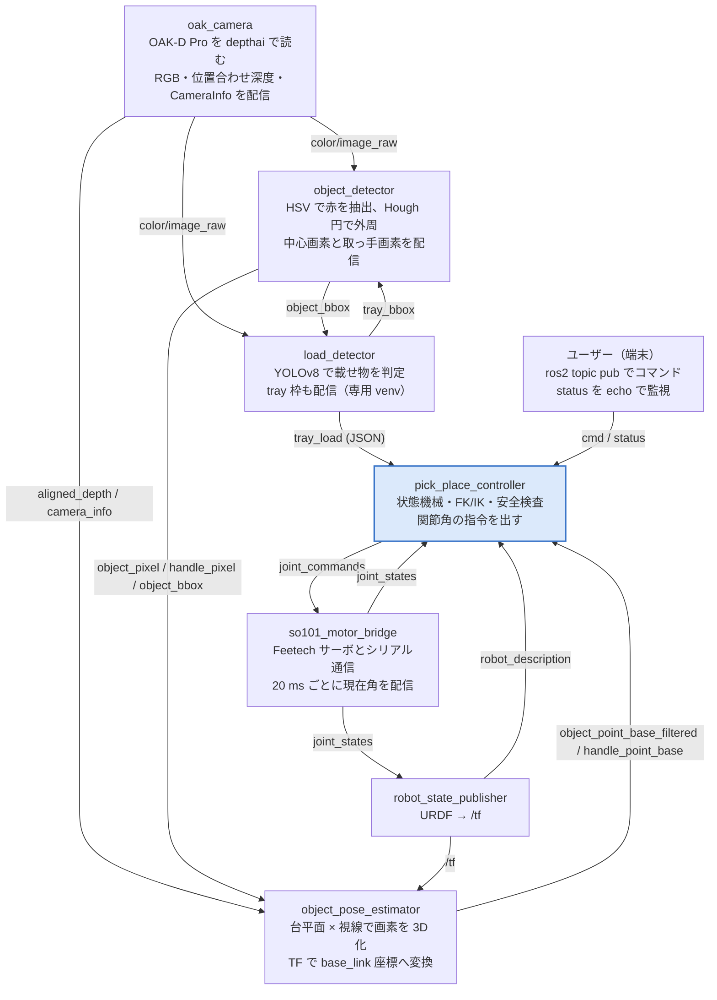
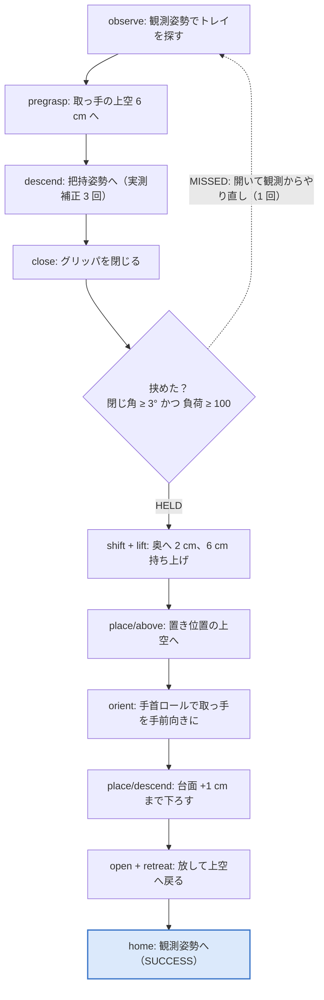

# SO-101 Pick & Place で学ぶ ROS 2 入門

作成: 2026-10-26。本リポジトリのプログラム（ROS 2 パッケージ `so101_pick_place`）を教材に、ROS 2 の基本概念を「動いている実例」から学ぶための勉強用資料。

目次

1. [この資料の目的と読み方](#1-この資料の目的と読み方)
2. [ROS 2 の基本概念（本プログラムの例で）](#2-ros-2-の基本概念本プログラムの例で)
3. [システム全体像](#3-システム全体像)
4. [題材 1: カメラノード `oak_camera` — Publisher の基本](#4-題材-1-カメラノード-oak_camera--publisher-の基本)
5. [題材 2: 物体検出ノード `object_detector` — Subscriber と Publisher](#5-題材-2-物体検出ノード-object_detector--subscriber-と-publisher-の組み合わせ)
6. [題材 3: 姿勢推定ノード `object_pose_estimator` — 座標系と TF](#6-題材-3-姿勢推定ノード-object_pose_estimator--座標系と-tf)
7. [題材 4: モータブリッジ `so101_motor_bridge` — ハードウェア I/O と安全](#7-題材-4-モータブリッジ-so101_motor_bridge--ハードウェアとの-io-と安全設計)
8. [題材 5: 制御ノード `pick_place_controller` — 状態遷移・運動学・dry_run](#8-題材-5-制御ノード-pick_place_controller--状態遷移コマンド運動学dry_run)
9. [launch と params.yaml](#9-launch-と-paramsyaml--起動の仕組みとパラメータの渡し方)
10. [演習課題](#10-演習課題--読む動かす改造する)
11. [用語集と参考資料](#11-用語集と参考資料)

---

## 1. この資料の目的と読み方

本資料は、SO-101 アーム × OAK-D Pro カメラの Pick & Place プログラム（ROS 2 パッケージ `so101_pick_place`）を教材にして、ROS 2 の基本概念を「動いている実例」から学ぶための勉強用資料です。ROS 2 のチュートリアルで出てくる概念が、実際のロボットシステムではどう使われているかを一つずつ対応づけて説明します。

**対象読者**

- Python は読める（クラス、関数、辞書が分かる）が、ROS 2 は初めて、または `talker/listener` チュートリアルを終えたばかりの人
- 本リポジトリを引き継いで改良したい人、または同じ構成でロボットを組みたい人

**前提環境**

- Jetson（JetPack 6）、Ubuntu 22.04、ROS 2 Humble、Python 3.10
- ROS ワークスペースは `~/ros2_ws`、本パッケージは `~/ros2_ws/src/so101_pick_place` にシンボリックリンクされている
- 環境の読み込みは `source scripts/setup_env.sh`、確認は `bash scripts/check_env.sh`

**題材プログラムの概要**

手首にカメラを付けた 6 軸アームが、作業台上の赤いトレイ（直径 150 mm、取っ手付き）を見つけ、取っ手をつかんで持ち上げ、決められた位置に取っ手を手前向きにして置きます。コマンド一つで観測 → 把持 → 持ち上げ → 配置 → 復帰まで自動で動きます（2026-10-24 に実機で成功）。処理は「カメラ → 画像検出 → 3D 位置推定 → 動作計画と制御 → モータ駆動」という 5 段のノードに分かれており、それぞれが ROS 2 の典型的な役割（Publisher、Subscriber、TF、パラメータ、launch）を担っています。

**読み方**

1. まず「ROS 2 の基本概念」と「システム全体像」で用語と全体の流れをつかむ
2. 題材 1〜5 は上流（カメラ）から下流（モータ）の順に並べてある。各題材は「この節で学ぶ ROS の要素」→「コードの読みどころ」→「手を動かして確認するコマンド」の順で構成する
3. 最後の演習課題で、読む・動かす・改造する の 3 段階で理解を定着させる

**安全上の注意**

実機を動かす操作は本資料でも明示します。モータブリッジ `so101_motor_bridge` は起動直後にアームを動かすので、周囲を確認してから起動すること。シリアルバスにつなぐプログラムは常に 1 つだけにすること（2026-10-20 に同時起動でアームが暴走した事例あり）。コントローラの `dry_run` は既定で true なので、実機を動かすときだけ明示的に false にします。

---

## 2. ROS 2 の基本概念（本プログラムの例で）

ROS 2 は「小さなプログラム（ノード）を複数動かし、名前付きのデータ経路（トピック）でつなぐ」仕組みです。本プログラムの 5 つのノードはすべてこの型で書かれています。下の表の「本プログラムでの例」を見ながら各概念を覚えてください。

| 概念 | 一言でいうと | 本プログラムでの例 |
|---|---|---|
| ノード (Node) | 1 つの役割を持つプログラム。`rclpy.node.Node` を継承したクラス | `oak_camera`, `object_detector`, `object_pose_estimator`, `load_detector`, `pick_place_controller`, `so101_motor_bridge` |
| トピック (Topic) | ノード間で流れるデータの「名前付きパイプ」。出す側が Publisher、受ける側が Subscriber | `/camera/camera/color/image_raw`（画像）、`/so101_pick_place/object_pixel`（検出画素）、`/so101_follower/joint_commands`（関節指令） |
| メッセージ型 (msg) | トピックを流れるデータの型。パッケージ名/型名で指定 | `sensor_msgs/Image`, `sensor_msgs/CameraInfo`, `geometry_msgs/PointStamped`, `sensor_msgs/JointState`, `std_msgs/String` |
| header / stamp / frame_id | メッセージに付く「いつ」「どの座標系で」の情報 | 画像の `header.stamp` が検出画素にそのまま引き継がれ、推定ノードで深度画像と時刻照合される |
| パラメータ (Parameter) | ノードの設定値。コードを変えずに YAML や起動引数で変更できる | `config/params.yaml` に全ノード分。`dry_run`, `hsv_lower1`, `grasp_height_m` など |
| launch | 複数ノードをまとめて起動する Python スクリプト | `launch/pick_place.launch.py`（カメラ+検出+推定+制御+載せ物検出）、`launch/robot_tf.launch.py`（TF） |
| TF (tf2) | 座標系どうしの関係（位置と姿勢）を時刻付きで管理する仕組み | `base_link` → … → `gripper_link` → `camera_link` → `camera_color_optical_frame`。推定ノードがカメラ座標の点を `base_link` に変換する |
| URDF / xacro | ロボットの関節・リンク構造の記述。TF の元になる | `urdf/so101_with_camera.urdf.xacro`（SO-101 の URDF にカメラ取付を合成） |
| タイマー (Timer) | 一定周期でコールバックを呼ぶ | `oak_camera` は 2 ms ごとにカメラのキューを覗く。各ノードは 5 s ごとに統計をログ出力 |
| QoS | 通信の信頼性・履歴の設定 | `oak_camera` は RELIABLE / KEEP_LAST(5) で配信 |
| パッケージ (ament_python) | ノードを配布・ビルドする単位。`setup.py` と `package.xml` | `so101_pick_place/`。`entry_points` の `console_scripts` が `ros2 run` で呼べる名前を決める |

**最小のノードの形**

本プログラムの全ノードは次の骨格でできています。この形を覚えれば、どのファイルも「どこにパラメータ宣言があり、どこで購読・配信し、コールバックで何をするか」の 3 点で読めます。

```python
import rclpy
from rclpy.node import Node
from geometry_msgs.msg import PointStamped

class MyNode(Node):
    def __init__(self):
        super().__init__('my_node')                       # ノード名
        self.declare_parameter('threshold', 0.5)          # パラメータ宣言（既定値）
        th = self.get_parameter('threshold').value
        self.sub = self.create_subscription(               # 購読
            PointStamped, '/in', self.on_point, 10)
        self.pub = self.create_publisher(PointStamped, '/out', 10)   # 配信
        self.create_timer(5.0, self.report)              # 周期処理

    def on_point(self, msg):                              # コールバック
        out = PointStamped(); out.header = msg.header     # header を引き継ぐ
        out.point.x = msg.point.x * 2.0
        self.pub.publish(out)

    def report(self):
        self.get_logger().info('alive')

def main():
    rclpy.init()
    node = MyNode()
    try:
        rclpy.spin(node)                                  # コールバックを回し続ける
    except KeyboardInterrupt:
        pass
    finally:
        node.destroy_node()
        rclpy.shutdown()
```

**動いているシステムを外から観察するコマンド**

ROS 2 の強みは、ノードを止めずに外からデータを覗けることです。学習中は必ず別端末でこれらを打ちながらコードを読んでください。

```bash
ros2 node list                                   # 動いているノード
ros2 topic list                                  # 流れているトピック
ros2 topic info /so101_pick_place/object_pixel   # 型と Publisher/Subscriber 数
ros2 topic echo /so101_pick_place/object_pixel   # 中身を表示
ros2 topic hz /camera/camera/color/image_raw     # 周波数
ros2 param list /pick_place_controller           # パラメータ一覧
ros2 param get /pick_place_controller dry_run    # 値の確認
ros2 interface show geometry_msgs/msg/PointStamped   # 型の定義
ros2 run tf2_tools view_frames                   # TF の木を PDF 化
ros2 run tf2_ros tf2_echo base_link camera_color_optical_frame   # 2 座標系の関係
rqt_graph                                        # ノードとトピックの接続図
```

---

## 3. システム全体像



中央の 5 つ（oak_camera → object_detector → object_pose_estimator → pick_place_controller → so101_motor_bridge）が本パッケージの主経路で、上から下へ「画像 → 画素 → 3D 座標 → 関節角」と情報の形が変わっていきます。`load_detector` は主経路と枠（bbox）を交換し合い、`robot_state_publisher` は URDF から座標系の関係（/tf）を供給します。アームとやり取りするのは一番下の `so101_motor_bridge` だけで、これは既存パッケージ `so101_hw_interface` のノードです。

**主なトピック一覧**（`/so101_pick_place/` 以下は接頭辞を省略）

| トピック | 型 | 出す側 → 受ける側 | 中身 |
|---|---|---|---|
| `/camera/camera/color/image_raw` | sensor_msgs/Image (bgr8) | oak_camera → object_detector, load_detector | RGB 画像 |
| `/camera/camera/aligned_depth_to_color/image_raw` | sensor_msgs/Image (16UC1, mm) | oak_camera → object_pose_estimator | RGB に位置合わせした深度 |
| `/camera/camera/color/camera_info` | sensor_msgs/CameraInfo | oak_camera → estimator, controller | 内部パラメータ fx, fy, cx, cy |
| `object_pixel` | geometry_msgs/PointStamped | object_detector → estimator | トレイ中心の画素 (u, v)、z に面積 |
| `handle_pixel` | geometry_msgs/PointStamped | object_detector → estimator | 取っ手の把持画素、z に向き [rad] |
| `object_bbox` | sensor_msgs/RegionOfInterest | object_detector → estimator, load_detector | 円盤の外接正方形 |
| `object_partial_pixel` | geometry_msgs/PointStamped | object_detector → controller | 見切れたときの探索ヒント |
| `tray_bbox` | sensor_msgs/RegionOfInterest | load_detector → object_detector | YOLO が出したトレイ枠（円探索の ROI） |
| `tray_load` | std_msgs/String (JSON) | load_detector → controller | 「載っている」判定 |
| `object_point_base_filtered` | geometry_msgs/PointStamped | estimator → controller | トレイ中心 [m]、base_link、15 フレーム中央値 |
| `handle_point_base` | geometry_msgs/PointStamped | estimator → controller | 取っ手の把持点 [m]、base_link |
| `/tf`, `/tf_static` | tf2_msgs/TFMessage | robot_state_publisher, oak_camera → estimator | 座標系の関係 |
| `/robot_description` | std_msgs/String | robot_state_publisher → controller | URDF 本文（運動学の元） |
| `cmd` | std_msgs/String | ユーザー → controller | observe / pick_place / auto / stop など |
| `status` | std_msgs/String | controller → ユーザー | 進行状況 |
| `/so101_follower/joint_commands` | sensor_msgs/JointState | controller → motor_bridge | 目標関節角 [rad] |
| `/so101_follower/joint_states` | sensor_msgs/JointState | motor_bridge → controller, robot_state_publisher | 現在関節角、effort に負荷 |
| `debug_image`, `mask`, `load_debug_image` | sensor_msgs/Image | 各ノード → 人 | rqt_image_view で確認する可視化 |

---

## 4. 題材 1: カメラノード `oak_camera` — Publisher の基本

ファイル: [so101_pick_place/so101_pick_place/oak_camera_node.py](../so101_pick_place/so101_pick_place/oak_camera_node.py)（225 行）。センサから読んだデータを ROS メッセージにして流す、最も単純な「出すだけ」のノードです。ROS のカメラドライバが守るべき約束（トピック名、エンコーディング、header、CameraInfo、光学フレーム）が一通り詰まっています。

**この節で学ぶ ROS の要素**

- `create_publisher` と QoS
- `sensor_msgs/Image` と `cv_bridge`（OpenCV の ndarray ↔ ROS メッセージ）
- `sensor_msgs/CameraInfo`（内部パラメータ行列 K）
- `header.stamp` / `header.frame_id` の役割
- `StaticTransformBroadcaster`（動かない座標変換の配信）
- `create_timer` によるポーリング型のセンサ読み出し

**コードの読みどころ**

1. パラメータ宣言（`__init__` 冒頭）: `width`, `height`, `fps`, `mono_resolution`, `ir_laser_dot` など。ハードウェアの設定をコードに埋めずパラメータにするのが ROS 流。USB 2 でしか認識されないときは `-p width:=640 -p height:=360` で落とす。
2. Publisher の作成: `create_publisher(Image, f'{ns}/color/image_raw', qos)`。トピック名は旧 RealSense D455 のときと同じにしてあるので、下流のノードはカメラを入れ替えても変更不要です。これが「トピックで疎結合する」利点の具体例です。
3. QoS: `QoSProfile(reliability=RELIABLE, history=KEEP_LAST, depth=5)`。画像はサイズが大きいので depth を小さくして古いフレームを捨てる。
4. `_poll`（2 ms タイマー）: depthai のキューから RGB と深度を `tryGet` で取り、シーケンス番号が揃ったペアだけ `_publish` する。ブロックする読み出しをコールバック内でしないのが rclpy での定石です。
5. `_publish`: `cv2_to_imgmsg(img, encoding='bgr8')` で Image に変換し、`header.stamp` と `header.frame_id = camera_color_optical_frame` を付ける。深度は `16UC1`（ミリ単位の 16 bit 整数）で、RGB と同じ header を使う。下流はこの stamp を鍵に RGB と深度を照合します。
6. `_camera_info`: デバイスのキャリブレーションから 3×3 の K 行列を読み、`CameraInfo.k` に入れる。推定ノードは `k[0]=fx, k[4]=fy, k[2]=cx, k[5]=cy` を使う。
7. `_publish_static_tf`: `camera_link`（x 前, y 左, z 上）→ `camera_color_optical_frame`（x 右, y 下, z 前）の回転を 1 回だけ配信。ROS のカメラは「光学フレーム」という約束（REP 103 / REP 104）に従うので、画像座標から求めた XYZ は必ずこのフレームで表します。
8. `_stamp`: depthai のデバイス時刻と ROS 時刻のオフセットを最初のフレームで決める。センサ時刻を ROS 時刻にそろえる処理はドライバを書くときにほぼ必ず必要になります。

**手を動かして確認する**（アーム不要、カメラだけでよい）

```bash
source ~/vscode/muran2026_physicalAI_ver/scripts/setup_env.sh
ros2 run so101_pick_place oak_camera --ros-args -p width:=640 -p height:=360

# 別端末
ros2 topic list | grep camera
ros2 topic hz /camera/camera/color/image_raw             # 約 30 Hz
ros2 topic echo /camera/camera/color/camera_info --once  # K 行列と frame_id を確認
ros2 topic echo /camera/camera/color/image_raw --once --no-arr   # encoding, width, height, header
ros2 run rqt_image_view rqt_image_view                   # 画像を目で見る
ros2 run tf2_ros tf2_echo camera_link camera_color_optical_frame   # 静的 TF
```

**考えてみよう**

- RGB と深度の header.stamp を同じにしているのはなぜか。別々にしたら下流で何が起きるか（題材 3 の `depth_for` を読むと分かる）。
- `camera_info` を画像と同じ頻度で配信している理由は何か（途中から購読したノードも受け取れる）。

---

## 5. 題材 2: 物体検出ノード `object_detector` — Subscriber と Publisher の組み合わせ

ファイル: [so101_pick_place/so101_pick_place/object_detector.py](../so101_pick_place/so101_pick_place/object_detector.py)（388 行）。画像を受け取り、OpenCV で処理し、結果を小さなメッセージで出す「変換器」型のノードです。ROS のノードの大半はこの形です。画像処理の中身（HSV、Hough 円、RANSAC）は ROS とは無関係なので、ここでは「入出力の設計」に注目して読みます。

**この節で学ぶ ROS の要素**

- `create_subscription` とコールバック（`on_image`）
- パラメータの宣言と配列型パラメータ（`hsv_lower1: [0, 120, 70]`）
- `geometry_msgs/PointStamped` を「画素座標」の入れ物として流用する設計
- header の引き継ぎ（`pt.header = msg.header`）
- 複数トピックの購読と「最新値を覆うだけ」の合流（`on_tray_bbox`）
- `throttle_duration_sec` 付きログと 5 秒ごとの統計ログ
- デバッグ画像の配信（可視化をノードの責任にする）

**コードの読みどころ**

1. 購読: `create_subscription(Image, image_topic, self.on_image, 10)`。最後の 10 は QoS のキュー長。画像が来るたびに `on_image` が呼ばれます。
2. `on_image` の入口: `imgmsg_to_cv2(msg, desired_encoding='bgr8')` で ndarray に戻す。失敗しても落ちず `warn` を出して return するのが作法。
3. 出力の形: トレイ中心は `PointStamped` の `x=u, y=v, z=面積` として配信。専用の msg 型を作らず既存型を借りると、`ros2 topic echo` や rqt でそのまま見られます。ただし単位が m でないので docstring で必ず明記する。
4. header の引き継ぎ: `pt.header = msg.header`。入力画像の stamp と frame_id をそのまま付けることで、次のノードが「どの時刻の深度画像と組み合わせるか」を判断できます。ROS で最も大切な習慣の一つです。
5. 「見えていなければ出さない」: 未検出や見切れのときは `object_pixel` を配信しません。下流はメッセージが来ないことで「動かない」を選べます。代わりに `object_partial_pixel` で探索ヒントだけを出す。
6. 別ノードからのヒント: `on_tray_bbox` は YOLO のトレイ枠を受け取り、受信時刻と一緒に保存するだけ。`fit_rim_edges` が「1 秒以内の新鮮な枠」のときだけ使います。コールバックでは保存し、判断は主処理でする、という分け方です。
7. パラメータの扱い: 宣言した値を `__init__` で一度だけ読み、`self.lower1` などに入れておく。コールバック内で毎回 `get_parameter` を呼ぶのは遅いので避けています（その代わり実行中の変更は反映されない）。
8. 処理解像度: `process_scale` で縮小して処理し、座標をフル解像度に戻して配信する。Jetson の CPU で 30 Hz を出すための工夫。

**手を動かして確認する**

```bash
P=~/ros2_ws/install/so101_pick_place/share/so101_pick_place/config/params.yaml
ros2 run so101_pick_place object_detector --ros-args --params-file $P -p process_scale:=1.0

# 別端末
ros2 topic echo /so101_pick_place/object_pixel         # 赤いトレイを見せると流れる
ros2 run rqt_image_view rqt_image_view /so101_pick_place/debug_image
ros2 param get /object_detector hsv_lower1
ros2 param set /object_detector publish_debug false   # 実行中に変えても反映されないことを確かめる
rqt_graph                                              # oak_camera → object_detector の線を見る
```

**考えてみよう**

- `ros2 param set` で変えた値を実行中に反映させるには、コードをどう変えればよいか（ヒント: `add_on_set_parameters_callback`）。
- カメラを 1280x720 に戻したとき、`process_scale` と `min_area_px` はどう変えるべきか。

---

## 6. 題材 3: 姿勢推定ノード `object_pose_estimator` — 座標系と TF

ファイル: [so101_pick_place/so101_pick_place/object_pose_estimator.py](../so101_pick_place/so101_pick_place/object_pose_estimator.py)（379 行）。画素座標 (u, v) をカメラ座標の XYZ にし、それをロボットの土台座標 `base_link` に変換します。ROS で「センサが見たものをロボットが扱える座標にする」ときの定石がすべて入っています。

**この節で学ぶ ROS の要素**

- 座標系（frame）と TF の木: `base_link → shoulder_link → … → gripper_link → camera_link → camera_color_optical_frame`
- `tf2_ros.Buffer` + `TransformListener`（/tf を聞いて木を組み立てる）
- `lookup_transform(target, source, time)` と `tf2_geometry_msgs.do_transform_point`
- 時刻照合: stamp の近い深度フレームを選ぶ（`depth_for`）
- `CameraInfo` の K から視線ベクトルを作る（ピンホールカメラモデル）
- `visualization_msgs/Marker` で RViz に点を出す

**座標系の約束（覚えること）**

| フレーム | 軸の向き | 誰が配信するか |
|---|---|---|
| `base_link` | 土台固定。本機では +x が後ろから見て左、-y が奥、+z が上 | URDF の根（robot_state_publisher） |
| `gripper_link` | グリッパに固定。-z が指先方向、+x が指の閉じる方向 | robot_state_publisher（joint_states から計算） |
| `camera_link` | カメラ本体。x 前, y 左, z 上 | URDF（xacro で gripper_link に合成、値は `config/camera_mount.yaml`） |
| `camera_color_optical_frame` | 画像の座標。x 右, y 下, z 光軸（前） | oak_camera の静的 TF |

カメラが手首についているので、関節が動くと `base_link → camera_color_optical_frame` の変換は時々刻々変わります。だから TF は「時刻付き」で、画像の stamp の時刻の変換を引くのが正しい作法です。

**コードの読みどころ**

1. TF の準備: `self.tf_buffer = Buffer(); self.tf_listener = TransformListener(self.tf_buffer, self)`。この 2 行で `/tf` と `/tf_static` を購読し、バッファに木を保持します。
2. 深度のバッファ: `on_depth` は最新の 45 フレームを `deque` に溜めるだけ。`on_pixel` が来たとき `depth_for(stamp)` で「stamp が最も近い深度」を選び、差が `max_stamp_diff_s` (50 ms) を超えたら捨てます。検出ノードの処理遅れを吸収するための設計です（`message_filters` の ApproximateTime を手書きしたものと思ってよい）。
3. ピンホールモデル: `ray = [(u-cx)/fx, (v-cy)/fy, 1]`。このベクトルに深度 Z を掛ければカメラ座標の XYZ になります。本プログラムは物体表面の深度を信用せず、周囲の作業台に平面を当てて視線との交点を取ります（`fit_table_plane`, `point_on_plane`）。OAK の IR ドットが無地の赤い面で誤マッチするためです。
4. カメラ座標の点を配信: `cam.header.frame_id = camera_color_optical_frame`。frame_id を正しく付けると、RViz でそのまま正しい場所に表示されます。
5. base_link への変換: `lookup_transform(base_frame, cam.header.frame_id, stamp)` を試し、無ければ `Time()`（最新）で代用。その後 `do_transform_point(cam, tf)`。コールバックをブロックしないよう `wait` せず、失敗したら `TransformException` を捕まえて警告を出して終わります。
6. 高さゲート: base 座標の z が `base_z_min_m`〜`base_z_max_m` を外れたら捨てる。床にある赤い物（z ≈ -0.72 m）を拾った実例から入った対策です。
7. フィルタ: 直近 15 フレームの中央値を `object_point_base_filtered` に配信。制御ノードはこちらだけを読みます。生値とフィルタ値を別トピックにすると、デバッグで両方を比べられます。
8. `publish_marker`: `Marker.SPHERE` を 0.5 秒の寿命で出す。RViz で Marker を追加するだけで推定点が見えます。

**手を動かして確認する**（アーム無しで TF だけ試すことができる）

```bash
# 関節角ゼロのダミー joint_states で TF を出す（アーム不要）
ros2 launch so101_pick_place robot_tf.launch.py use_fake_joints:=true rviz:=true

# 別端末
ros2 run tf2_tools view_frames                 # frames.pdf ができる。木を確認
ros2 run tf2_ros tf2_echo base_link camera_color_optical_frame
ros2 topic echo /tf_static --once             # oak_camera と robot_state_publisher の静的変換
ros2 topic echo /so101_pick_place/object_point_base_filtered
```

ここで `tf2_echo` の値をメモしておき、あとで `camera_rpy` を launch 引数で変えて（例: `camera_rpy:="0 0.5 -1.57"`）値がどう変わるか見ると、xacro 引数 → URDF → TF の流れが体感できます。

**考えてみよう**

- `lookup_transform` で画像時刻の TF が引けないのはどんなときか（ヒント: joint_states は 50 Hz、TF バッファは時間を補間するが未来は補間できない）。
- アームが動いている最中に最新 TF で代用すると何が起きるか。本プログラムが「観測姿勢で静止してから計測する」理由を説明できるか。

---

## 7. 題材 4: モータブリッジ `so101_motor_bridge` — ハードウェアとの I/O と安全設計

ファイル: `~/ros2_ws/src/Lerobot_ros2/src/so101_hw_interface/so101_hw_interface/motor_bridge.py`（既存パッケージを本プロジェクトで改変。本リポジトリには含まれない）。サーボ 6 個（Feetech STS3215）とシリアル通信し、ROS の世界とモータの世界を橋渡しします。ROS で「ハードウェアの境界」をどう設計するかの実例です。

**この節で学ぶ ROS の要素**

- `sensor_msgs/JointState` の使い方（`name` と `position` の対応、`effort` の流用）
- 「指令はトピックで受け、実際の書き込みはタイマーで」という分離
- キャリブレーションファイル（YAML）と URDF の関節角の対応づけ
- ハードウェアノードに特有の安全機構（排他ロック、読み取り失敗での停止）
- トピック名の相対指定（`so101_follower/joint_states`）と名前空間

**コードの読みどころ**

1. パラメータ: `port`（シリアルデバイス）、`calib_file`、`startup_pose`（mid / hold / zero）、`acceleration`、`p_coefficient`。ポートは `/dev/ttyACM0` のような番号ではなく `/dev/serial/by-id/usb-1a86_USB_Single_Serial_5AB9068796-if00` のようにシリアル番号で指定する（差し順で番号が変わるため）。
2. 排他ロック: `acquire_bus_lock(port)`（`bus_lock.py`）。`/tmp/so101_bus_<port>.lock` を `flock` し、取れなければ終了する。同じバスに 2 プログラムがつながるとパケットが衝突してアームが暴走した事故（2026-10-20）から生まれた仕組みです。ROS の機能ではなく OS の機能ですが、ハードウェアノードにはこういう層が必要です。
3. 購読: `so101_follower/joint_commands`（JointState）。`_command_cb` はメッセージに含まれる関節だけ `current_commands` を更新する。だから制御ノードはグリッパだけ、アーム 5 軸だけ、といった部分指令を送れます。
4. タイマー `_timer_cb`（20 ms = 50 Hz）: サーボから `Present_Position` をまとめ読み（sync_read）し、キャリブの `homing_offset` と `direction` で rad に変換して `joint_states` に配信。その後 `current_commands` をステップ値に戻して `Goal_Position` に書く。シリアルアクセスを 1 つのタイマーに集約すると、バスの使用が常に順序だてになります。
5. `effort` の流用: `Present_Load` を `joint_states.effort` に入れている。制御ノードはこれを「把持できたか」の判定（負荷 ≥ 100）に使います。既存メッセージのフィールドを流用するときは、単位が標準（N·m）と違うことをコメントと docstring に明記します。
6. 停止条件: 読み取りに `max_consecutive_read_failures`（10）回連続で失敗、またはトルク OFF（リセット）を検知したら指令を止める。電源が負荷で落ちた痕跡から入った対策です。
7. `startup_pose:=hold`: 起動時に現在姿勢を保持して動かない。既定の `mid` は可動範囲中央へ動くので、周囲の安全を確かめてから起動すること。

**JointState の読み方**

```yaml
# ros2 topic echo /so101_follower/joint_states --once
header: {stamp: {...}, frame_id: ''}
name: [shoulder_pan, shoulder_lift, elbow_flex, wrist_flex, wrist_roll, gripper]
position: [0.01, -0.14, -0.86, 1.61, -1.55, 0.02]   # rad、URDF のゼロ姿勢基準
velocity: []
effort: [12.0, 240.0, 85.0, 30.0, 4.0, 0.0]          # Present_Load の生値（非標準）
```

`name` と `position` は同じ順番で対応します。受け取る側は `dict(zip(msg.name, msg.position))` のように名前で引くのが安全です（制御ノードの `on_js` がその例）。

**手を動かして確認する**（実機を動かす。アームを支え、周囲を確認してから）

```bash
ros2 run so101_hw_interface so101_motor_bridge --ros-args \
  -p port:=/dev/serial/by-id/usb-1a86_USB_Single_Serial_5AB9068796-if00 \
  -p calib_file:=$HOME/.so101_follower_calibration.yaml -p startup_pose:=hold -p p_coefficient:=32

# 別端末
ros2 topic hz /so101_follower/joint_states          # 約 50 Hz
ros2 topic echo /so101_follower/joint_states        # トルクが入っているので手では動かない。値を読むだけ
# グリッパだけ 20° 開く（部分指令の例。指先に何もないことを確認）
ros2 topic pub --once /so101_follower/joint_commands sensor_msgs/JointState "{name: [gripper], position: [0.35]}"
```

ブリッジを Ctrl+C で止めるとトルクが切れてアームが脱力します。止める前にアームを支えるか寝かせてください。

**考えてみよう**

- `joint_commands` を受けたコールバックで直接サーボに書かず、タイマーで書くのはなぜか（ヒント: シリアルは同時に 1 つしか話せない）。
- ROS 2 には `ros2_control` という標準のハードウェア抽象層がある。本プログラムがそれを使わず単純なトピックブリッジにした利点と欠点を挙げてみよう。

---

## 8. 題材 5: 制御ノード `pick_place_controller` — 状態遷移、コマンド、運動学、dry_run

ファイル: [so101_pick_place/so101_pick_place/pick_place_controller.py](../so101_pick_place/so101_pick_place/pick_place_controller.py)（733 行）と [kinematics.py](../so101_pick_place/so101_pick_place/kinematics.py)（160 行）。上流の計測結果を読み、「どこへどう動くか」を決めて関節角を出す、システムの頭脳です。ファイルは長いですが、「コールバックは記録だけ、動作はワーカースレッド」という骨格を捉えれば読めます。



`stop` コマンドはどの段階でも割り込み、次の指令で現在角を保持して中断します。`auto` はこの流れの前に `wait_load`（YOLO が「載っている」を 2 秒続けて判定するまで待つ）を挟みます。

**この節で学ぶ ROS の要素**

- `std_msgs/String` をコマンドトピックに使う簡易なインターフェース（正式には Service / Action がある）
- コールバックをブロックしない設計（ワーカースレッド + `busy` / `abort` フラグ）
- `TRANSIENT_LOCAL` QoS で `/robot_description` を後から受け取る
- URDF を自分で読んで FK / IK をする（MoveIt を使わない最小構成）
- `dry_run` パラメータによる安全なテスト
- 状態の外部公開（`status` トピック）とログの二重出力

**コードの読みどころ**

1. 購読するものとコールバック: `on_js`（関節角）、`on_obj`（トレイ中心）、`on_handle`（把持点）、`on_load`（YOLO 判定）、`on_partial`（見切れヒント）、`on_cam_info`。どれも「最新値と受信時刻を保存するだけ」です。判断はしません。
2. `/robot_description` の QoS: `QoSProfile(depth=1, reliability=RELIABLE, durability=TRANSIENT_LOCAL)`。robot_state_publisher は URDF を起動時に 1 回だけ配信するので、後から起動したノードが受け取るにはこの設定（ラッチング）が必須です。忘れると「永遠に waiting for /robot_description」になります。
3. `on_cmd`: 文字列を見て `threading.Thread(target=self._run)` を起こす。動作は数十秒かかるので、コールバック内で実行すると `joint_states` の受信が止まってしまいます（rclpy の既定 executor は単一スレッド）。`stop` だけは `abort` フラグを立てて即座に返る。
4. `send` と `dry_run`: 関節角を `JointState` に詰めて `cmd_pub.publish`。`dry_run` が true なら publish しない。実機を動かすコードはこの 1 箇所だけに集約されています。
5. `move_to`: 現在角から目標角へ cos 補間しながら 20 ms ごとに `send`。途中で `joint_states` が 0.5 秒途切れたら例外で停止、`abort` なら現在角を送って保持。到達後は `settle_time_s` 待って実測角を返す。
6. `move_with_correction`: 実測と目標の差を指令に上乗せして最大 3 回繰り返す。サーボの重力側への数度の垂れを吸収するため。指令を変えても動かない関節があれば「限界または干渉」とみなして打ち切ります。
7. 運動学 `SO101Kinematics`: URDF の XML を `xml.etree` で読み、`joint` の origin / axis / limit を集めて 4×4 行列の連鎖で FK を計算。IK は scipy の `least_squares` で「TCP 位置 + 接近方向」の残差を最小化します。ロボットの形状をコードに書かず URDF を唯一の真実にするのが ROS の思想です。
8. 安全検査: `check_limits`（キャリブ範囲 ∩ URDF 範囲 ∩ サーボ内部制限）、`ensure_clear`（経路上で TCP / カメラ / グリッパが台面 + 5 cm を下回らないか `path_min_heights` で確認）、高さゲート `table_z_tolerance_m`。動く前に必ず計算で検査し、ダメなら動かない。
9. `do_observe`: 観測姿勢で 3 秒待ち、`obj_hist` に 10 点以上溜まったら中央値を記憶。見えなければ見切れヒントから肩旋回の修正量を計算して振る（最大 5 姿勢、±60°）。見つかった旋回角は `~/.so101_pick_place_last_pan` に保存して次回最初に試す。
10. `do_grasp` の把持判定: 閉じた後の `js['gripper']` と `js_effort['gripper']` を見て HELD / MISSED を決める。センサを足さず、あるデータ（サーボの負荷）を流用した例です。

**手を動かして確認する**（まず dry_run で。アームは動かない）

```bash
# ブリッジと TF、カメラ・検出・推定が動いている前提
ros2 run so101_pick_place pick_place_controller --ros-args --params-file $P   # dry_run は既定 true

# 別端末
ros2 topic echo /so101_pick_place/status
ros2 topic pub --once /so101_pick_place/cmd std_msgs/String "{data: observe}"
ros2 topic pub --once /so101_pick_place/cmd std_msgs/String "{data: plan}"      # IK と経路検査だけ
ros2 topic pub --once /so101_pick_place/cmd std_msgs/String "{data: stop}"
```

`status` に `[dry_run: no command sent]` と出ることを確かめてから、実機では `-p dry_run:=false` を付けて起動し直します。ノードを再起動するときは `ros2 run` のラッパーだけでなく子プロセスまで pid で止めること（止め損ねると controller が二重になり、同じコマンドを 2 つが実行する）。

**考えてみよう**

- コマンドを `std_msgs/String` ではなく ROS 2 の Action（目標・進捗・結果・キャンセルを持つ）で作ると、`busy` / `abort` / `status` のどれが不要になるか。
- `move_to` の中で `time.sleep(0.02)` を使っている。`create_timer` で書き直すとしたら状態をどう持つべきか。

---

## 9. launch と params.yaml — 起動の仕組みとパラメータの渡し方

ノードを 1 つずつ `ros2 run` するのは学習には良いですが、実運用では launch ファイルでまとめて起動し、設定は YAML に集約します。本パッケージには launch が 2 つ、設定ファイルが 2 つあります。

| ファイル | 役割 | 学べること |
|---|---|---|
| [launch/pick_place.launch.py](../so101_pick_place/launch/pick_place.launch.py) | カメラ・検出・推定・制御・載せ物検出を一括起動 | `Node` アクション、`DeclareLaunchArgument`、`IfCondition`、`ExecuteProcess` |
| [launch/robot_tf.launch.py](../so101_pick_place/launch/robot_tf.launch.py) | URDF を xacro で展開し robot_state_publisher を起動 | `Command` 置換、`ParameterValue`、`remappings`、ダミー関節の切替 |
| [config/params.yaml](../so101_pick_place/config/params.yaml) | 全ノードのパラメータ（ノード名ごとにセクション） | `<node_name>: ros__parameters:` の構造 |
| [config/camera_mount.yaml](../so101_pick_place/config/camera_mount.yaml) | カメラ取付の xyz / rpy | launch が Python で読んで既定値にするパターン |

**params.yaml の構造**

```yaml
object_detector:            # ノード名（super().__init__('object_detector') と一致させる）
  ros__parameters:          # このキーは固定
    image_topic: /camera/camera/color/image_raw
    hsv_lower1: [0, 120, 70]
    process_scale: 0.5
pick_place_controller:
  ros__parameters:
    dry_run: true
    observation_pose_deg: [0.0, -8.0, -49.0, 92.0, -88.6]
```

パラメータの優先順位は「コードの `declare_parameter` の既定値 < `--params-file` < `-p name:=value`」です。README の起動例で `--params-file $P -p dry_run:=false` と書いているのは、YAML の安全な既定（true）を実機のときだけコマンドラインで上書きするためです。型は既定値で決まるので、`declare_parameter('fps', 30)` に `-p fps:=30.0` を渡すと型不一致でエラーになります。

**pick_place.launch.py の読みどころ**

1. `get_package_share_directory('so101_pick_place')` で install 先の `share/` を引き、`config/params.yaml` のパスを作る。ソースツリーではなく install 先を見るので、YAML を変えたら `colcon build` が必要です（`--symlink-install` ならリンクなので不要）。
2. `Node(package=..., executable=..., name=..., parameters=[params])`。`executable` は `setup.py` の `console_scripts` の名前、`name` は YAML のセクション名に対応。
3. `DeclareLaunchArgument('use_camera', default_value='true')` + `condition=IfCondition(use_camera)`。`ros2 launch ... use_camera:=false` でカメラノードだけ外せます。
4. `ExecuteProcess(cmd=[script, '--ros-args', '--params-file', params])`。YOLO は PyTorch を別 venv に隔離しているので `Node` ではなくシェルラッパー `scripts/run_load_detector.sh` を起動します。ROS の引数はそのまま渡せます。
5. モータブリッジと TF はこの launch に入っていません。ブリッジは起動時にアームを動かし得るので、人が目で確認してから手で起動するという判断です。「何を自動化しないか」も設計です。

**robot_tf.launch.py の読みどころ**

1. `Command([xacro, urdf_path, ' camera_xyz:=', camera_xyz, ...])`。launch が実行時に xacro コマンドを呼び、展開した URDF 文字列を `robot_description` パラメータとして robot_state_publisher に渡します。`ParameterValue(..., value_type=str)` がないと YAML として解釈されて壊れます。
2. `remappings=[('/joint_states', joint_states_topic)]`。robot_state_publisher は既定で `/joint_states` を読むが、ブリッジは `/so101_follower/joint_states` に出す。コードを触らずトピック名をつなぎ替えるのが remap です。
3. `use_fake_joints:=true` で `joint_state_publisher` が関節角ゼロを出す。アーム無しで TF と RViz を試せる。
4. `_load_mount()` は launch が普通の Python であることを利用して YAML を読み、launch 引数の既定値にしています。

**パッケージのビルドと配布物**

`setup.py` の `data_files` が launch / config / urdf を `share/so101_pick_place/` にコピーし、`entry_points` が `ros2 run so101_pick_place <name>` で呼べる実行ファイルを作ります。`package.xml` の `<depend>` は `rosdep` が依存を入れるための宣言です。

```bash
cd ~/ros2_ws && colcon build --symlink-install --packages-select so101_pick_place
source install/setup.bash
ros2 pkg executables so101_pick_place        # entry_points の一覧
ros2 launch so101_pick_place pick_place.launch.py --show-args   # launch 引数の一覧
ros2 launch so101_pick_place pick_place.launch.py use_controller:=false use_load_detector:=false
```

---

## 10. 演習課題 — 読む・動かす・改造する

各段階を順に進めてください。「動かす」まではアーム無し（カメラと `use_fake_joints`）でできます。「改造する」はまず `dry_run: true` のまま試し、動作を確かめてから実機に進みます。

**段階 1: 読む**

- [ ] `rqt_graph` を見ながら、「システム全体像」の図と同じ接続があることを確かめる。図に無いトピックがあれば、どのノードが何のために出しているかコードで調べる
- [ ] 5 つのノードそれぞれについて、`declare_parameter` / `create_subscription` / `create_publisher` / `create_timer` の行を数え、表にする
- [ ] `object_pixel` が配信されてから `object_point_base_filtered` が出るまでに、どの関数がどの順で呼ばれるかを書き出す
- [ ] `ros2 interface show` で `PointStamped`, `JointState`, `CameraInfo`, `RegionOfInterest` の定義を見て、本プログラムが標準と違う意味で使っているフィールドを全部挙げる（例: `PointStamped.z` に面積）

**段階 2: 動かす**（アーム不要）

- [ ] `oak_camera` だけ起動し、`ros2 topic hz` で 3 つのトピックの周波数を記録する。`fps` パラメータを 15 にして変化を見る
- [ ] `object_detector` を起動し、`hsv_lower1` の S を 120 → 200 にして検出がどう変わるか `debug_image` で見る（`-p hsv_lower1:="[0,200,70]"`）
- [ ] `robot_tf.launch.py use_fake_joints:=true rviz:=true` で RViz を開き、TF 表示を追加して `camera_color_optical_frame` の向きを確かめる。`camera_rpy` を変えて再起動し、向きが変わることを見る
- [ ] 推定ノードを起動し、RViz に `object_marker` を追加して赤い球がトレイの位置に出ることを見る（ダミー関節なので位置は実際と違う。なぜ違うか説明する）
- [ ] `ros2 bag record` でカメラ 3 トピックを 10 秒録音し、`ros2 bag play` で再生しながら `object_detector` を動かす（カメラ無しで検出を試せる環境を作る）

**段階 3: 改造する**（まず dry_run で）

- [ ] 初級: `object_detector` に `publish_debug` を実行中に切り替えられる `add_on_set_parameters_callback` を追加する
- [ ] 初級: 推定ノードに「平面フィットの rms と inlier 率」を `std_msgs/Float32MultiArray` で配信するトピックを足し、`rqt_plot` で時系列を見る
- [ ] 中級: コマンド `cmd` を `std_msgs/String` から ROS 2 Service（`std_srvs/Trigger` など）に置き換え、成功・失敗を呼び出し側に返す
- [ ] 中級: `pick_place.launch.py` に `dry_run` の launch 引数を追加し、`ros2 launch ... dry_run:=false` で制御ノードに渡るようにする（ヒント: `parameters=[params, {'dry_run': LaunchConfiguration('dry_run')}]`）
- [ ] 中級: 検出色を赤以外（例: 青）にする。HSV の Hue が 1 区間で済むためコードが簡単になる箇所を見つける
- [ ] 上級: 制御ノードの `move_to` をワーカースレッド + `time.sleep` から、`MultiThreadedExecutor` + Action サーバに書き替える
- [ ] 上級: モータブリッジを `ros2_control` の hardware interface として実装し、`joint_trajectory_controller` で動かす（`so101_follower_moveit/config/ros2_controllers.yaml` の関節名の不一致を直すことから始める）

**デバッグの心得（本プロジェクトで実際に効いたもの）**

- まず `ros2 topic hz` と `ros2 topic echo`。データが来ていないのか、来ているが値がおかしいのかを切り分ける
- `header.stamp` を疑う。時刻がずれていると `depth_for` や `lookup_transform` が黙って捨てる（警告は `throttle` されているのでログをよく見る）
- デバッグ画像トピックは惜しまず作る。数値ログより画像の方が原因が早く分かる
- ノードが二重に起動していないか `ros2 node list` で確かめる。同名ノードが 2 つあるとコマンドが 2 回実行される

---

## 11. 用語集と参考資料

| 用語 | 意味 |
|---|---|
| rclpy | ROS 2 の Python クライアントライブラリ。`Node`, `spin`, QoS などを提供 |
| executor / spin | コールバック（購読・タイマー）を順に実行するループ。既定は単一スレッドなので、長い処理は別スレッドへ |
| QoS | Quality of Service。RELIABLE / BEST_EFFORT、KEEP_LAST(depth)、TRANSIENT_LOCAL（後から来た購読者にも最後の値を渡す）など |
| header | `std_msgs/Header`。`stamp`（時刻）と `frame_id`（座標系名）。Stamped と名の付くメッセージはこれを持つ |
| TF / tf2 | 座標系の木を時刻付きで管理する仕組み。`/tf`（動くもの）と `/tf_static`（固定） |
| URDF / xacro | ロボット記述の XML。xacro はマクロと引数を使える拡張 |
| robot_state_publisher | URDF と joint_states から `/tf` を計算して出す標準ノード |
| 光学フレーム (optical frame) | カメラ画像の座標系。x 右、y 下、z 前（REP 103） |
| CameraInfo / K 行列 | カメラの内部パラメータ。fx, fy（焦点距離 px）、cx, cy（主点 px） |
| cv_bridge | OpenCV の ndarray と `sensor_msgs/Image` の相互変換 |
| FK / IK | 順運動学（関節角 → 手先位置）/ 逆運動学（手先位置 → 関節角） |
| TCP | Tool Center Point。本機では gripper_link 原点から指先方向に `tcp_offset_m` 進んだ点 |
| launch | 複数ノードの起動と引数・条件・remap を記述する Python |
| remap | コードを変えずにトピック名を別名につなぎ替える |
| colcon / ament_python | ROS 2 のビルドツールと Python パッケージのビルド方式 |
| Service / Action | 要求応答型の通信。Action は進捗とキャンセルを持つ。本プログラムは使っていない（演習課題） |
| ros2 bag | トピックの録音・再生 |

**本リポジトリ内の資料**

- [README.md](../README.md): 起動手順と主なパラメータ
- [docs/システム解説_2026-10-25.md](システム解説_2026-10-25.md): 検出・推定・制御のアルゴリズムの詳細
- [docs/環境確認結果_2026-10-13.md](環境確認結果_2026-10-13.md): 開発経緯と計測記録（失敗事例を含む）
- [SO101_RealSense_Pick_and_Place_実装計画.md](../SO101_RealSense_Pick_and_Place_実装計画.md): 当初の計画（STEP 1〜6 の構成）

**公式ドキュメント**

- [ROS 2 Humble チュートリアル](https://docs.ros.org/en/humble/Tutorials.html)（Beginner: CLI Tools → Client Libraries の順）
- [rclpy API](https://docs.ros.org/en/humble/p/rclpy/)
- [tf2 チュートリアル](https://docs.ros.org/en/humble/Tutorials/Intermediate/Tf2/Tf2-Main.html)
- [launch ファイル](https://docs.ros.org/en/humble/Tutorials/Intermediate/Launch/Launch-Main.html)
- [REP 103: 座標系の約束](https://www.ros.org/reps/rep-0103.html) / [REP 105: フレーム名](https://www.ros.org/reps/rep-0105.html)
- [sensor_msgs/CameraInfo](https://docs.ros2.org/latest/api/sensor_msgs/msg/CameraInfo.html)
- [ros2_control](https://control.ros.org/humble/index.html)（演習課題の上級向け）
