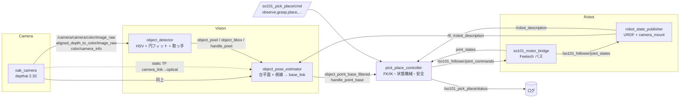

# SO-101 × OAK-D Pro Pick & Place システム解説（2026-10-25 時点、同日夕方の変更を反映）

本書は、現在動いているプログラムの構成と、各処理を技術的にどう実現しているかをまとめたもの。
経緯・計測値の記録は `docs/環境確認結果_2026-10-13.md`、計画は `SO101_RealSense_Pick_and_Place_実装計画.md`。

## 1. 何ができるか

本プログラムは、パンケーキ焼きロボット全体（① SO-101 がパンケーキメーカーを開ける → ② 装置が焼印を押す → ③ 別ロボットがパンケーキをお皿に乗せる → ④ SO-101 がお客さんに差し出す）のうち、工程 ④「お客さんに差し出す」を実現するもの（写真は `docs/photo/`、概要は `README.md`）。

作業台上の赤いトレイ（直径 150 mm、取っ手付き）を手首カメラで見つけ、取っ手を掴んで持ち上げ、指定位置に置いて戻る。
`ros2 topic pub --once /so101_pick_place/cmd std_msgs/String "{data: pick_place}"` の 1 コマンドで、
観測（見えなければ肩旋回で探索）→ 把持（空振りなら観測からやり直し）→ 奥へ 2 cm → 持ち上げ → 配置（取っ手を手前向きに）→ 開放 → 観測姿勢、まで自動で実行する（2026-10-24 に実機で成功、2026-10-25 に探索・配置を拡張）。

## 2. ハードウェア

| 要素 | 内容 |
|---|---|
| アーム | SO-101 follower（Feetech STS3215 ×6、12 V）。USB シリアル（CH343、シリアル番号 5AB9068796） |
| グリッパ | 交換済み（v10）。固定爪の先端は `gripper_link` 原点から 64 mm、可動爪は約 39 mm。指は gripper_link の x 方向に開閉 |
| カメラ | OAK-D Pro（RGB + ステレオ深度 + IR ドット）を手首の 35° ブラケットに取付。USB 3 接続が本来だが現在は USB 2 認識のため 640×360 で運用 |
| 計算機 | Jetson（JetPack 6 / L4T R36.5.2、Ubuntu 22.04、ROS 2 Humble、Python 3.10） |
| 電源 | サーボ用 12 V（5 A 以上に交換済み。元の 2 A では負荷姿勢でブラウンアウト） |

## 3. ソフトウェア構成



パッケージ `so101_pick_place`（約 2,000 行、MIT）のノードと役割:

| ノード（実行名） | ファイル | 役割 |
|---|---|---|
| `oak_camera` | `oak_camera_node.py` | OAK-D Pro から RGB・位置合わせ深度・CameraInfo を D455 と同じトピック名で配信 |
| `load_detector` | `load_detector.py` | 自前データで微調整した YOLOv8n でトレイの上の載せ物（パンケーキ・アメ・ケーキ）とトレイ枠を検出 |
| `object_detector` | `object_detector.py` | 赤色トレイの円盤中心・外接円・取っ手の方向と把持画素を検出 |
| `object_pose_estimator` | `object_pose_estimator.py` | 画素 → カメラ座標 → base_link 座標。作業台平面方式 |
| `pick_place_controller` | `pick_place_controller.py` | コマンド受付、観測・把持・配置の状態機械、IK、補正、安全検査 |
| `so101_calibrate_zero` | `calibrate_zero.py` | URDF ゼロ姿勢基準のキャリブレーション |
| （ライブラリ） | `kinematics.py` | URDF 直読みの FK / 数値 IK / ロール解 / 経路高さ検査 |
| launch | `robot_tf.launch.py`, `pick_place.launch.py` | TF 配信、一式起動 |
| 設定 | `config/params.yaml`, `config/camera_mount.yaml`, `urdf/so101_with_camera.urdf.xacro` | 全パラメータ、カメラ取付、URDF 合成 |

既存パッケージ `Lerobot_ros2`（`~/ros2_ws/src`）の `so101_hw_interface/motor_bridge.py` を改変して使用（4 章）。

## 4. 各処理の実現方法

### 4.1 カメラ配信（`oak_camera_node.py`）

- depthai 2.x の Pipeline を構築: ColorCamera（1080p を ISP で 1280×720 または 640×360 に縮小、**BGR**）、MonoCamera ×2（400P）、StereoDepth（LR チェック、extended disparity、subpixel、confidence 230、median OFF、`setDepthAlign(CAM_A)` で RGB に位置合わせ、出力サイズを RGB に一致）。
- RGB と深度を `getSequenceNum()` で対にし、同一 stamp で `/camera/camera/color/image_raw`（bgr8）と `/camera/camera/aligned_depth_to_color/image_raw`（16UC1, mm）を配信。CameraInfo はデバイスのキャリブレーションから `getCameraIntrinsics(CAM_A, w, h)`。
- `camera_link → camera_color_optical_frame` の static TF（光学系への回転のみ）を配信。IR ドットプロジェクタは 0.15。
- 設計上の理由: Jetson 用の apt に depthai-ros が無かったため pip の depthai で自前実装。トピック名を D455 と同じにして下流を変更不要にした。

### 4.2 検出（`object_detector.py`）

1. 処理解像度に縮小（`process_scale`）→ HSV → 赤を 2 区間（H 0–10 と 170–180、S ≥ 120、V ≥ 70）で二値化 → open/close。
2. 最大輪郭を取り、円盤の円を求める。現在は **`center_method: rim_edge`**（2026-10-26）: 探索範囲は、学習モデル（`load_detector` の `tray` クラス、`/so101_pick_place/tray_bbox`）のトレイ枠が新鮮ならその 1.3 倍（半径の見当 = 枠の辺の半分、探索 0.75〜1.3 倍）、無ければ赤領域の外接円の 1.8 倍。その範囲の灰色画像に **Hough 円変換**をかけ、投票上位 15 候補について「円のすぐ内側が赤系か（f_in ≥ 0.4、載せ物の縁の円を捨てる）」「赤系画素の 55% 以上が円の内側か（小さすぎる円を捨てる）」を検査し、縁の支持率（円周のうち Canny エッジに乗る割合）+ 0.3×内包率 − 0.3×外側の赤率 が最大の候補を採用する。ラップの反射で赤マスクが虫食いになっても、大きなパンケーキで縁が隠れても、トレイ外周は強いエッジとして残るので安定する（赤輪郭への円フィット `rim_circle` はパンケーキの縁に引きずられて中心が 3〜5 cm ずれた）。解けないときは `rim_circle` に戻る。1 フレーム 25〜100 ms。
3. **取っ手**: 円を 1.15 倍に広げた外側に残る赤領域の重心方向を取っ手の向きとし、その軸上で「縁から先端までの 60%」の点を把持画素にする（CAD 上、幅 9 mm の板の区間に当たる）。
4. **見切れ除外**: 円が画面端（余白 `border_margin_px`）に触れていたら検出を出さない（中心がずれるため）。
5. 出力: `object_pixel`（u, v, 面積。header は画像と同じ stamp）、`object_bbox`（**円の外接正方形**。推定側の除外範囲に使う）、`handle_pixel`（u, v, 角度）、デバッグ画像、マスク。
6. 見切れたときは `object_partial_pixel` に赤領域の重心と画面中心からの水平位置（-1〜+1）を出す。controller はこれを旋回探索のヒントに使う。

### 4.3 3D 位置推定（`object_pose_estimator.py`）

- 深度は直近 6 フレームを stamp 付きで保持し、画素の stamp に最も近いフレームを使う（許容 50 ms）。
- **作業台平面方式**（`depth_mode: table_plane`）: 物体表面の深度は OAK では信用できない（無地の赤い面で IR ドット格子が誤マッチ）ため、物体の外接矩形の周囲（除外 1.6×、リング 2.5×）の深度点を間引いて 3D 化し、リング内深度の中央値 ±10 cm の点だけで **RANSAC 平面フィット**（inlier 最多、8 mm）→ 最小二乗精緻化。平面は 0.3 s ごとに再フィットして再利用（30 Hz を維持）。妥当性検査: inlier 率 ≥ 0.25、rms ≤ 12 mm、法線と光軸の角 ≤ 80°、交点距離が min/max 内。
- 物体中心の**視線と台平面の交点**をカメラ座標の 3D 点とし、`tf2` で画像 stamp（無ければ最新）の TF を引いて base_link に変換。待ち時間を作らないよう TF 参照はブロッキングしない。
- トレイ中心の画素は縁の上端（台面 +18 mm）を見ているので、`plate_height_m` の面で視線を切ってから台面に落とす（台面で切ると約 1.4 cm 奥にずれる）。
- 取っ手の把持点は、台平面をカメラ側に `handle_height_m`（0.032 m、板の上面）だけ平行移動した面で視線を切る。台面で切ると、高さ × 水平距離 ÷ カメラ高さ（約 1 cm）だけカメラから遠い側にずれ、観測姿勢によっては取っ手の横方向の誤差になる（2026-10-25 に固定爪に当たる原因として判明）。
- base での高さが `base_z_min_m`〜`base_z_max_m`（-0.10〜0.30 m）を外れた点は出さない（右側の床にある赤い物を z=-0.72 m で拾った対策）。
- 平面候補は inlier 最多の 70% 以上の中から**最も低い（カメラから遠い）平面**を選ぶ（`plane_prefer_lowest`）。リングに入ったホットプレートの天板など、台より高い面を台と誤るのを防ぐ。深度フレームは 45 枚（1.5 s）保持し、検出の処理遅れ（最大 0.2 s）でも同時刻の深度を使える。
- 出力: `object_point_camera`、`object_point_base`、`object_point_base_filtered`（直近 15 フレームの中央値。controller はこれを使う）、`handle_point_base`、RViz 用 Marker。

### 4.4 TF と運動学（`robot_tf.launch.py`, `camera_mount.yaml`, `kinematics.py`）

- `so101_with_camera.urdf.xacro` が SO-101 の既存 URDF を取り込み、OAK の `camera_link`（RGB レンズ位置、x 前・y 左・z 上）を `gripper_link` に固定接続（D455 用の分岐は 2026-10-26 に削除）。取付値は `camera_mount.yaml`（D455 ブラケットの CAD から算出し、OAK の上下逆取付（光軸まわり 180°）を実測で補正）。
- `robot_state_publisher` が motor bridge の `/so101_follower/joint_states` で TF を配信。`use_fake_joints:=true` でアーム無しに TF だけ確認できる。
- `kinematics.py` は `/robot_description` の URDF を直接パースし、関節原点と軸から **FK**（TF と一致を確認済み）を計算する。**IK** は 5 関節（pan, lift, elbow, wrist_flex, wrist_roll）のうち roll を固定し、`scipy.optimize.least_squares` で「TCP 位置（3）＋接近方向（重み 0.05）」の残差を関節範囲（キャリブ範囲 ∩ URDF ∩ サーボ内部制限）付きで最小化。TCP は gripper_link 原点から指先方向（-z）に `tcp_offset_m`、閉じ方向（x）に `tcp_lateral_m`。
- **ロール解**: IK 後に wrist_roll だけを走査し、指の閉じ方向（gripper_link の x）が取っ手軸と直交する角を選ぶ（現在値に近い方を優先）。
- **経路高さ検査**: 関節補間経路を 41 分割して TCP・camera_link・gripper_link の最低高さを求め、台面＋余裕を下回る移動は拒否。

### 4.5 制御（`pick_place_controller.py`）

- コマンド（`/so101_pick_place/cmd`, std_msgs/String）: `observe` / `plan` / `hover` / `pregrasp` / `descend` / `lift` / `grasp` / `place` / `pick_place` / `wait_load` / `auto` / `auto_loop` / `open` / `close` / `home` / `stop`。状態は `/so101_pick_place/status`。動作はワーカースレッドで実行し、コールバックを塞がない。
- **観測姿勢** `[pan 0, lift -8, elbow -49, wrist_flex 92, roll -88.6]°`: FK でグリッド探索して決めた。カメラ高さ 0.36 m、70° 見下ろし、光軸は土台前方 36 cm の台面。サーボ内部制限（lift ≥ -11°）内で成立する姿勢。
- **observe**: 観測姿勢へ移動し、3 s 間の `object_point_base_filtered` と `handle_point_base` の中央値を記憶（トレイ中心、取っ手把持点、取っ手軸）。見えないときは肩旋回を振って探す: 見切れヒントがあれば、その画像内角度 × `observe_pan_gain`（1.5）だけ旋回を修正（画像右 = ロボットの左 = 旋回マイナス）。ヒントだけが 1 s 続いた時点で次へ移る。ヒントが無ければ `observe_pan_search_deg` の順。±60°、最大 5 姿勢。見つかった旋回角は `~/.so101_pick_place_last_pan` に保存し、次回（再起動後も）最初に試す。観測した台面高さが `table_z_m` ± 5 cm を外れた検出（床など）は捨てる。
- **grasp**:
  1. 把持点 = トレイ中心 + `handle_grasp_radius_m`（0.108、CAD の板中央）× 計測した取っ手の向き（計測した距離は画素→3D の高さ差で 2〜3 cm ずれるので使わない。計測距離が 5〜16 cm を外れたら向きも信用せず観測し直す）。高さ = 固定の `table_z_m`（0.017）＋ `grasp_height_m`（0.030。取っ手の板は台面から 30〜33 mm で、板の上端付近を挟む。2026-10-26 に 0.020 から上げた）。観測した台面 z が 1.5 cm 以上ずれていれば警告する。閉じ方向の狙いは `tcp_lateral_m`（+0.016。2026-10-26 に 0.008 から広げた）で、板を固定爪の内側面から約 29 mm 可動爪側に置く。可動爪が板を固定爪へ寄せるので、右（可動爪側）のずれは許容され、左のずれは固定爪先端に当たって失敗する。
  2. 接近方向 = 鉛直から「土台→目標」の水平方向へ傾ける。傾きは 20°→50° を 5° 刻みで試し、最初に解けたものを使う（逆向きの傾きは手首限界に当たりほぼ解けない）。
  3. グリッパを開き（60°）、把持点から接近方向に沿って 6 cm 手前の**待機点**へ → 把持点へ下降 → 閉じる（1°）。
  4. **把持判定**: 閉じ角 ≥ 3° かつ負荷（joint_states.effort = Present_Load）≥ 100 なら HELD（9 mm の板で約 8°/200、つまみで約 18°/500）。空振りなら開いて持ち上げ、`pick_place` では観測からやり直し（1 回）。
  5. 把持した瞬間の取っ手の向き（中心→取っ手）をグリッパ座標系で記憶（置くときの向き合わせに使う）。
  6. `post_grasp_shift_xy`（奥へ 2 cm）だけ掴んだ高さのまま水平移動し、実測補正してから 6 cm 持ち上げ。
- **place**: 配置位置は `place_position_xyz` の x, y（絶対座標。現在は正面から左 5 cm・奥 30 cm。これは把持点＝取っ手の位置で、トレイ中心はそこから取っ手の向きに約 11 cm ずれる）。高さは台面＋把持高さ＋1 cm。取っ手の向きは `place_handle_axis_xy`（[0, 1] = 手前、ロボット側）に符号込みで合わせる: 記憶した取っ手ベクトルが base でその向きになる手首ロールを `solve_roll_signed` で求める。置くときの接近傾きは 0° から試し（`place_tilt_min_deg`）、まず現在のロールのまま上空 6 cm へ運び、工具軸がほぼ鉛直な上空でロールだけ回す（トレイが傾かない）。その後下降 → 開放 → 上空へ退避。
- **移動と補正**: 全移動は cos 補間、最大 15°/s。到達後に実測角と目標角の差を指令に上乗せ（ゲイン 0.8、最大 3 回）して、サーボの重力偏差（2〜6°）を吸収する。指令を変えても実測が動かない関節があれば補正を打ち切る（サーボ限界・干渉の検知）。
- **安全**: 関節範囲、サーボ内部制限（`shoulder_lift_min_deg -10`, `shoulder_pan_max_deg 64`）、経路最低高さ、TCP 高さ下限、台面近くからの大移動前に 6 cm 持ち上げる `ensure_clear`、joint_states 途絶で停止、`dry_run` 既定 true。

### 4.6 載せ物検出（`load_detector.py`）と `auto` コマンド

- 目的: トレイにアメ・ケーキなどが**載ったことを学習済み物体検出で確認してから**運び始める。
- モデル: 現在は**自前データで微調整した YOLOv8n `sweets_v2.pt`**（クラス pancake / candy / cake / tray。115 枚、検証 mAP50 pancake 0.995 / tray 0.995 / candy 0.37）。`tray` クラスの枠はトレイ検出の探索範囲として `object_detector` に渡す（ラップの反射やピンクのホットプレートで赤色だけではトレイを見失ったため）。画像全体で推論（GPU 約 40 ms、imgsz 416）。経緯: COCO モデルはカップケーキを認識できず、ゼロショットの YOLO-World（語彙 candy/cake/cupcake/…）は位置は取れるが名前（アメ）を区別できなかったため、自前学習に切り替えた。YOLO-World 経路と色フォールバック（円内の非赤面積。手やラップの反射で誤判定した）は 2026-10-26 のリファクタで削除。
- 判定: トレイの円（`object_detector` の外接円が新鮮ならそれ、無ければ tray 枠の内接円）の内側に中心がある `trigger_labels`（pancake / candy / cake）の検出を「載せ物」とする。長辺がトレイ直径の `max_box_frac`（0.98）倍を超える枠はトレイ自体とみなして除外する。
- 出力: `/so101_pick_place/tray_load`（JSON: loaded, loaded_by, n_inside, tray_seen, items[label, conf, u, v, inside, ignored, box], infer_ms）、`/so101_pick_place/tray_bbox`（tray 枠）、`/so101_pick_place/load_debug_image`。
- 実行環境: Jetson の apt numpy と pip PyTorch が衝突するため、PyTorch・ultralytics は `~/.venvs/yolo-gpu`（予備: CPU 版 `~/.venvs/yolo`）に隔離し、`scripts/run_load_detector.sh` 経由で起動する（launch の `use_load_detector`）。
- controller: `wait_load` は観測姿勢でトレイを見つけたまま待ち、`loaded` が 2 s（`load_confirm_s`）続いたら戻る。`auto` = `wait_load` → `pick_place`、`auto_loop` は `stop` まで繰り返す。判定が 1.5 s より古ければ無効、トレイが見つからなければ 5 s ごとに探し直す。

### 4.7 モーターブリッジの改変（`Lerobot_ros2/so101_hw_interface/motor_bridge.py`）

- `startup_pose`（mid / **hold** / zero）: 起動時に動かない hold を追加（元は可動範囲中央へ移動）。
- `bus_lock.py`: 同じシリアルポートを 2 プロセスが開けないようにする flock（同時起動でアームが暴走した事故の再発防止）。
- 連続 10 回の読み取り失敗、または復帰時にトルク OFF（電源リセット）を検知したら指令を停止。
- キャリブレーション yaml の `direction`（符号）、エンコーダ 0/4095 またぎ（home 基準 ±2048 の差分で扱う）、`acceleration`（既定 40、元は 254）、`p/i/d_coefficient`（P=32 推奨。元は 16 で偏差大）、起動時のレジスタ表示（P/I/D、トルク制限、内部位置制限、ホーミングオフセット、電圧、温度）。
- `joint_states.effort` に Present_Load を載せ、把持判定と診断に使う。

### 4.8 キャリブレーション（`calibrate_zero.py`, `scripts/rezero_from_bridge.py`）

- URDF のゼロ姿勢（上腕鉛直・前腕水平・グリッパ直進・可動爪が上・カメラが後ろから見て左に縦）に手で合わせ、そのエンコーダ値を 0 とする。可動範囲は home 基準の差分で記録（またぎ対応）。`range_only_joints` / `zero_only` で部分更新可。
- `rezero_from_bridge.py` はブリッジ稼働中（トルクを切らずに）現在角を指定関節の 0 にできる。
- 関節の符号は「基準姿勢で測った皿位置を別姿勢の TF で画像に再投影し、実測画素と比べる」方法で検証済み（全軸正）。

## 5. 主要パラメータ（`config/params.yaml`）

| 区分 | 主なもの |
|---|---|
| 検出 | HSV 範囲、`rim_edge_in_min 0.4`、`rim_edge_contain_min 0.55`、`disk_radius_px_min/max`、`handle_grasp_fraction 0.6`、`border_margin_px` |
| 推定 | `plane_annulus_scale 2.5`、`plane_exclude_scale 1.6`、`plane_ring_depth_gate_m 0.10`、`plane_update_period_s 0.3`、`filter_window 15`、`handle_height_m 0.032`、`base_z_min_m/-max_m -0.10/0.30` |
| 制御 | `observation_pose_deg`、`observe_pan_search_deg [0,-30,30]`、`observe_pan_gain 1.5`、`observe_pan_max_deg 60`、`observe_state_file`、`table_z_tolerance_m 0.05`、`approach_tilt_deg 20〜50`、`pregrasp_distance_m 0.06`、`grasp_height_m 0.030`、`lift_height_m 0.06`、`tcp_offset_m 0.064`、`tcp_lateral_m 0.016`、`gripper_open_deg 70`、`gripper_close_deg 1`、`grasp_check_*`、`post_grasp_shift_xy [0,-0.02]`、`place_position_xyz [0.05,-0.30,-]`、`place_handle_axis_xy [0,1]`、`place_tilt_min_deg 0`、`max_joint_speed_deg_s 15`、`correction_iterations 3` |
| カメラ | `width/height`、`mono_resolution 400p`、`extended_disparity`、`ir_laser_dot 0.15` |
| 載せ物検出 | `model sweets_v2.pt`、`trigger_labels [pancake, candy, cake]`、`conf 0.08`、`tray_conf 0.3`、`imgsz 416`、`rate_hz 4.0`、`max_box_frac 0.98`; 制御側 `load_confirm_s 2.0`、`load_wait_timeout_s 0` |

## 6. 起動手順（現在の運用）

```bash
# 端末1: モーターブリッジ（アームを支えて起動。起動時は動かない）
source scripts/setup_env.sh
ros2 run so101_hw_interface so101_motor_bridge --ros-args -p port:=$SO101_FOLLOWER_PORT \
  -p calib_file:=$HOME/.so101_follower_calibration.yaml -p startup_pose:=hold -p p_coefficient:=32
# 端末2: TF
ros2 launch so101_pick_place robot_tf.launch.py
# 端末3: カメラ（USB 2 の間は 640x360）、検出、推定、制御
ros2 run so101_pick_place oak_camera --ros-args --params-file <params> -p width:=640 -p height:=360
ros2 run so101_pick_place object_detector --ros-args --params-file <params> -p process_scale:=1.0 -p min_area_px:=800 -p border_margin_px:=4
ros2 run so101_pick_place object_pose_estimator --ros-args --params-file <params> -p plane_stride:=2 -p plane_min_points:=400
ros2 run so101_pick_place pick_place_controller --ros-args --params-file <params> -p dry_run:=false
# 実行
ros2 topic pub --once /so101_pick_place/cmd std_msgs/String "{data: pick_place}"
```
`<params>` は `~/ros2_ws/install/so101_pick_place/share/so101_pick_place/config/params.yaml`。USB 3 に戻れば `pick_place.launch.py`（既定 1280×720）で一括起動できる。起動手順の全体は `README.md`。

## 7. 設計上の制約と、その根拠になった計測

- **近距離の深度は使えない**: D455 は約 25 cm 未満で全欠損、OAK は無地面で IR ドットが誤マッチ。→ 観測姿勢（35 cm 以上）で測って記憶し、接近中は深度に頼らない。台面平面方式で物体表面の深度を使わない。
- **サーボは数度ずれる・たわむ**（STS3215 ＋ 3D プリント）: 偏差は補正ループで吸収、TF は実測角で計算するので垂れは座標誤差にならない。
- **サーボ内部の位置制限**（肩 -11°、旋回 +65°）と**手首曲げ 102°**がリーチを制約: 観測姿勢と接近方向の向きはこれに合わせて決めた。
- **到達性**: 把持点は土台から 16〜32 cm が実用範囲。トレイは 25〜33 cm 前方に置く。
- **把持の横方向許容は非対称**: 可動爪は板を固定爪側へ寄せるので、板は固定爪から約 29 mm 可動爪側を狙う（`tcp_lateral_m 0.016`。2026-10-25 に 9 mm → 21 mm、2026-10-26 に 29 mm へ広げ、開き角も 60° → 70°）。
- **台より高い点を台平面で切らない**: 取っ手（高さ 3 cm）は板の高さの面で切る。約 1 cm の系統誤差の原因だった。

## 8. 既知の課題

- OAK が USB 2 認識（ケーブル/コネクタ疑い）。1280×720 に戻すには USB 3 復帰が必要。
- 新グリッパでは「閉じ切る角度」がキャリブ範囲外（可動範囲の再記録が未実施）。
- 把持点が取っ手のつまみ寄りになることがある（`handle_grasp_fraction` の調整余地）。
- 成功率の統計はまだ（1 回成功）。載せ物が円盤からはみ出すと平面推定が乱れる。
- 空振りで取っ手に当たるとトレイが 2〜3 cm 動く。やり直しの観測で追従するが、当てない精度が本筋。
- controller は取っ手把持点とトレイ中心の距離が 8.5〜14 cm（CAD 約 10.8 cm）を外れた観測を捨てて観測し直す（`handle_dist_min/max_m`）。2026-10-26 にパンケーキで円が内側に寄り、取っ手点がトレイの中に出た対策。
- 作業台の外（床）に赤い物があると観測時間を浪費する（高さゲートで捨てる）。
- MoveIt 2 は未使用（自前 IK で足りているため）。
- 載せ物検出は GPU 版 venv で約 35〜40 ms/推論（CPU 版 venv では約 0.6 s）。640×360 入力では確信度が低めに出るためしきい値 0.08。candy は学習枠が 9 個しかなく mAP50 0.37 で、データ追加が課題。USB 3 復帰（1280×720）で改善余地。ultralytics は AGPL-3.0。
