# Physical AI 応用 1 講座 最終課題 説明資料

**課題名**: ROS を用いた SO-101 によるパンケーキ皿の自律 Pick & Place

**omnicampus アカウントID**: 142123

**動画**: https://youtu.be/79h9IVhPGWI 

**コード**: https://github.com/droplet-of-star/pancake_2026_physicalAI_ver

---

## 0. どんなプログラム？

手首カメラ付きの SO-101 アームが、パンケーキの載った赤いトレイを見つけて取っ手を掴み、お客さんの前に取っ手を手前向きにして置くための ROS 2 ソフトウェア


何をするか

1 コマンド（auto）を送ると、観測 → パンケーキが載ったことを物体検出で確認 → 取っ手の位置を 3D 推定 → 接近・把持 → 把持できたか判定（空振りならやり直し）→ 持ち上げ → 置き位置の上空で取っ手を手前向きに回す → 置いて離す → 観測姿勢に戻る、までを自律で行います。

中身の構成

自作の ROS 2 ノードが 6 つあり、役割分担はこうです。

oak_camera: OAK-D Pro から RGB と位置合わせ済み深度を配信する。

object_detector: 色と Hough 円変換でトレイの縁の円と取っ手の向きを画像上で求める。

object_pose_estimator: 周囲の台面に平面を当て、画素の視線との交点で 3D 位置を出し、ロボット座標に変換する。

load_detector: 自前データで微調整した YOLOv8n で「パンケーキが載った」を判定する。

pick_place_controller: URDF 直読みの運動学で経路を解き、移動後に実測角で補正しながら把持・配置を進める状態機械。安全チェックもここ。

so101_calibrate_zero: サーボの原点合わせ。
モーター通信は公開パッケージ Lerobot_ros2 のブリッジを安全機能つきに改変して使っています。


---

## 1. 課題の概要と目的

### 1.1 何をするロボットか

サークルで製作中の**パンケーキ焼きロボット**は、4 つの工程を複数のロボットで分担する。本課題はその最終工程「お客さんに差し出す」を担当する。

| 工程 | 担当 |
|---|---|
| ① パンケーキメーカーを開ける | SO-101 |
| ② 焼印を押す | 焼印装置 |
| ③ パンケーキをお皿に乗せる | 別ロボット |
| ④ **お客さんに差し出す** | **SO-101（本課題）** |

<table>
<tr>
<td align="center">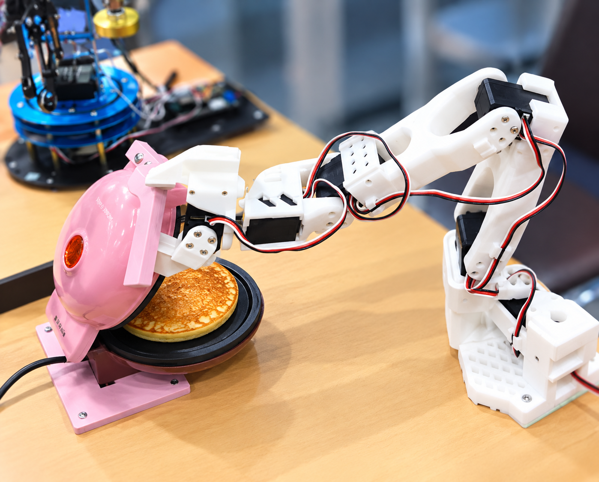<br>① メーカーを開ける</td>
<td align="center">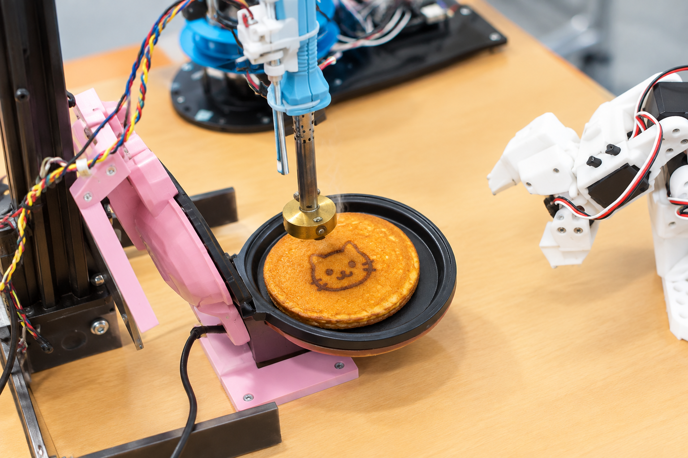<br>② 焼印を押す</td>
<td align="center">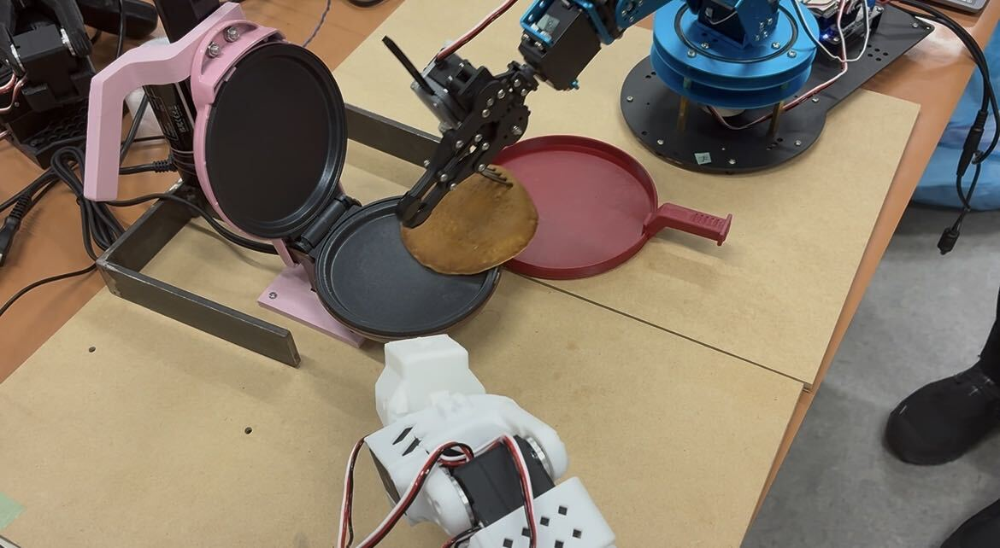<br>③ お皿に乗せる</td>
<td align="center">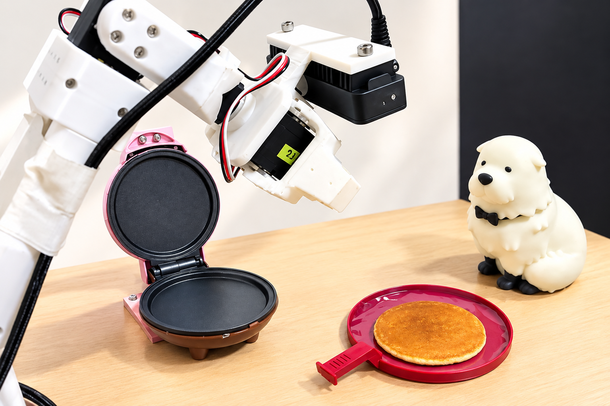<br>④ お客さんに差し出す</td>
</tr>
</table>

工程 ④ の中身は次の通り。作業台の上の**赤いトレイ（直径 150 mm、取っ手付き）**を手首の深度カメラで見つけ、**取っ手を掴んで**持ち上げ、決めた位置に**取っ手を手前向きにそろえて**置く。

1 つのコマンドで、次の一連の動作を自律的に行う。

```
観測（見えなければ首を振って探す）
→ 【AI】トレイにパンケーキが載ったことを物体検出で確認
→ 取っ手の把持点を 3D 推定 → 接近 → 把持 → 把持判定（空振りならやり直し）
→ 奥へ 2 cm 寄せて持ち上げ → 配置位置の上空で取っ手を手前向きに回す
→ 降ろして離す → 観測姿勢へ戻る
```

「空のトレイは運ばず、パンケーキが載ったら運ぶ」という配膳の判断は、自前データで微調整した物体検出モデル（YOLOv8n）で行う。

### 1.2 なぜこのタスクか

**選定理由**

- **サークルのロボットの一工程を切り出した。** 「お客さんに差し出す」は講座の内容（ROS 2・カメラ・アーム制御）と重なりが大きく、完成すればそのまま本番の装置に組み込める。
- **仕事で ROS を使い始めたので、理解を深めたかった。** ノード設計、TF、URDF、逆運動学を、シミュレーションではなく実機で一通り自分の手で通すことを目標にした。
- **深度カメラを使ってみたかった。** 手首のステレオ深度カメラで物体の 3D 位置を推定し、その値でアームを動かすところまでを経験したかった。
- **学習ベース（VLA）ではなくモデルベースの制御を選んだ。** 展示の場では照明や机、背景が開発環境と変わるので、見た目に依存する方策は動かなくなるおそれがあり、教示データの収集にも手間がかかる。認識は物体検出に限定し、動作は幾何（平面推定・運動学）で組み立てる方が、環境が変わっても調整しやすく、失敗の原因も追いやすい。

### 1.3 使用した機材・ソフトウェア

| 項目 | 内容 |
|---|---|
| アーム | SO-101 follower（Feetech STS3215 サーボ ×6、12 V）。グリッパは自作 CAD で短縮・改造（固定爪 64 mm、可動爪 39 mm） |
| カメラ | OAK-D Pro（RGB + ステレオ深度 + IR ドット投光）。手首に 35° の自作ブラケットで固定。開発初期は RealSense D455 |
| 計算機 | Jetson（Ubuntu 22.04、ROS 2 Humble、Python 3.10） |
| 主なライブラリ | rclpy, tf2, robot_state_publisher, xacro, OpenCV, NumPy, SciPy, depthai, PyTorch + YOLOv8n |
| 対象物 | 自作 CAD のトレイ（直径 150 mm、縁 18 mm、取っ手は幅 9 mm の板が台面から 30〜33 mm の高さ） |

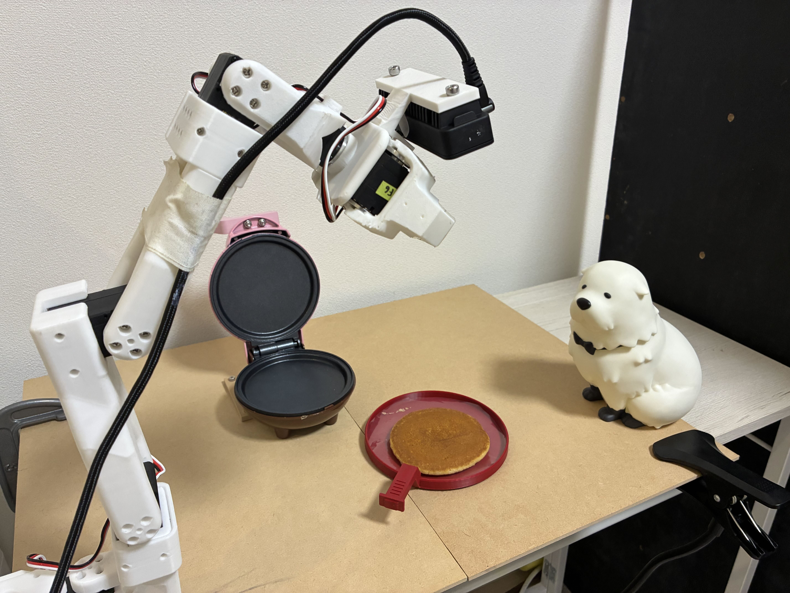

実機の全景。手首に OAK-D Pro を付けた SO-101 が観測姿勢からトレイを見ている。手前がパンケーキメーカー、右がお客さん役の置物。

<table>
<tr>
<td align="center">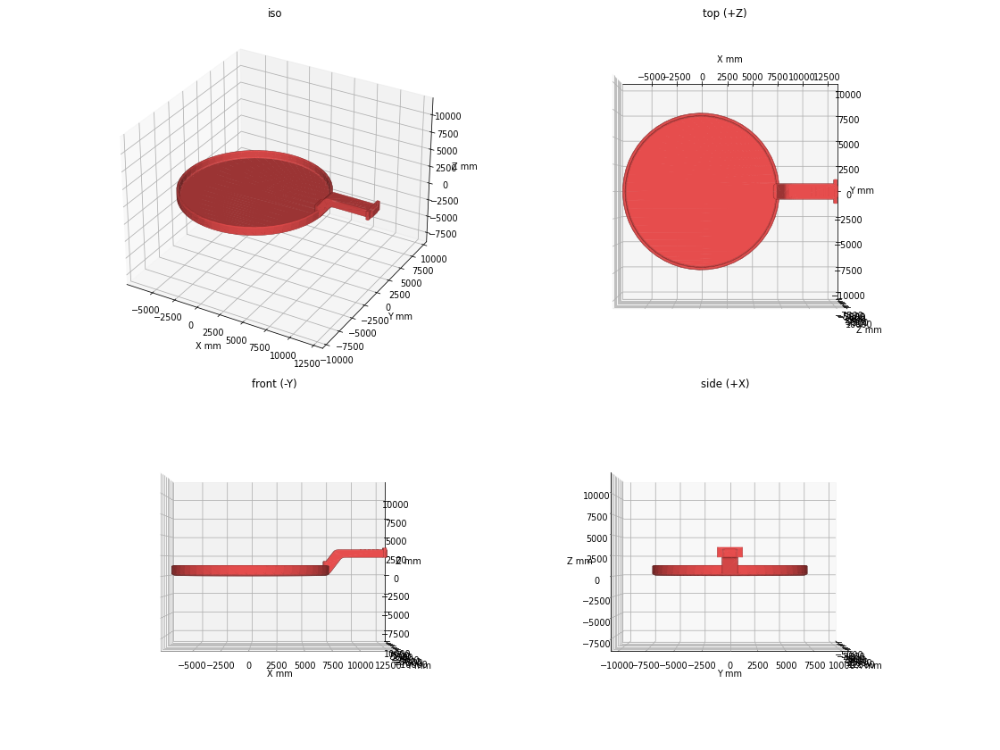<br>トレイ</td>
<td align="center">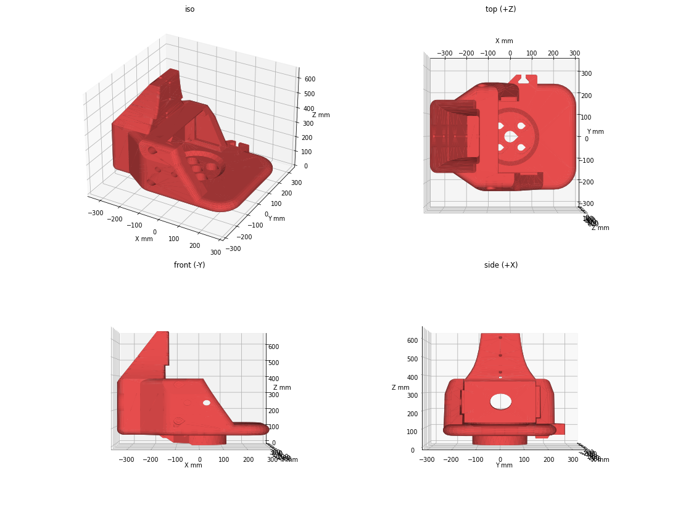<br>グリッパ本体（短縮）</td>
<td align="center">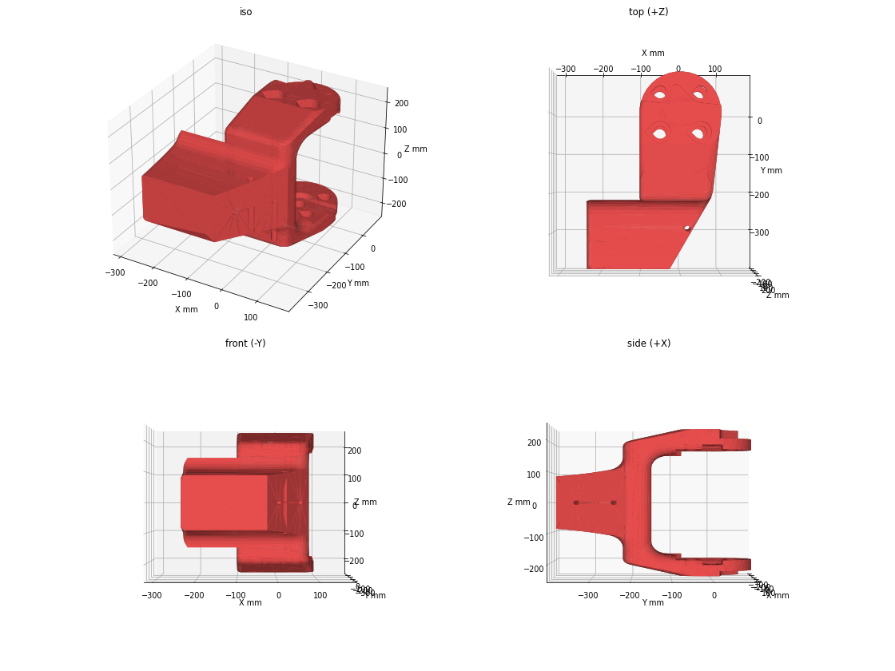<br>可動爪</td>
</tr>
</table>

---

## 2. システム構成

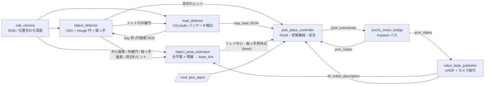

ROS 2 ノードを 6 つ自作した（Python、約 2,300 行）。モーターブリッジは公開パッケージ（Lerobot_ros2）を改変して使った。

| ノード | 役割 |
|---|---|
| `oak_camera` | depthai でパイプラインを組み、RGB、RGB に位置合わせした深度、CameraInfo を同じ stamp で配信 |
| `object_detector` | HSV で赤を抽出し、Hough 円変換と色の整合でトレイの縁の円（中心・半径）を求める。円の外側の赤から取っ手の向きと把持画素を出す |
| `object_pose_estimator` | 画素の視線と作業台平面（RANSAC で推定）の交点から 3D 位置を求め、TF で base_link へ変換し、中央値フィルタをかける |
| `load_detector` | 微調整した YOLOv8n でトレイの上のパンケーキとトレイ枠を検出し、「運んでよいか」を判定 |
| `pick_place_controller` | URDF を直読みした FK/IK、観測・把持・配置の状態機械、到達後の実測補正、安全チェック |
| `so101_calibrate_zero` | URDF のゼロ姿勢に手で合わせてエンコーダ原点を記録する |

---

## 3. 技術的な実現方法と工夫した点

先に要点をまとめる。

| 節 | 問題 | 解決 |
|---|---|---|
| 3.1 | 近距離の深度がトレイ表面で欠損・誤マッチする | トレイ表面は読まず、周囲の台面に平面を当てて視線との交点を取る |
| 3.2 | パンケーキで赤領域が欠けると中心がずれる | Hough 円変換で縁の円を直接捉え、把持点は CAD 寸法で決める |
| 3.3 | 安価なサーボは重力で数度たわむ | 移動後に実測角を見て指令に上乗せする補正を最大 3 回 |
| 3.4 | MoveIt の設定不一致、手首の可動域が狭い | URDF 直読みの自前 IK、土台側へ傾けた放射状接近、ロールの 2 段階解法 |
| 3.5 | 空振りに気づけない | 閉じ角と負荷で把持を判定し、失敗なら観測からやり直す |
| 3.6 | 観測姿勢でトレイが見えない | 見切れヒントで肩旋回を振って探す |
| 3.7 | 空のトレイを運んでしまう | 自前学習の物体検出で「パンケーキが載ったら運ぶ」 |
| 3.8 | 実機の事故 | バスの排他ロック、リセット検知、経路の高さ検査、dry_run 既定 |
| 3.9 | カメラ取付位置の実測が難しい | CAD から算出し、再投影で検証 |
| 3.10 | ROS 2 の概念とコードが結びつかない | 自分のプログラムを教材にした勉強用資料を AI に書かせた |

### 3.1 近距離で信用できない深度を「台平面」で置き換える

**問題**。D455 は 25 cm 未満で深度が全欠損する。OAK-D Pro は無地の赤い面で IR ドットの誤マッチが起き、トレイ表面の深度が数 cm 単位で揺れる。把持には数 mm の精度が要る。

**解決**。トレイ表面の深度は使わない。トレイの周囲にある作業台の深度点に RANSAC で平面を当て、**トレイ中心画素の視線とその平面の交点**を 3D 位置とする。台は無地でも広く点が多いので、平面は安定する（rms 2〜4 mm）。

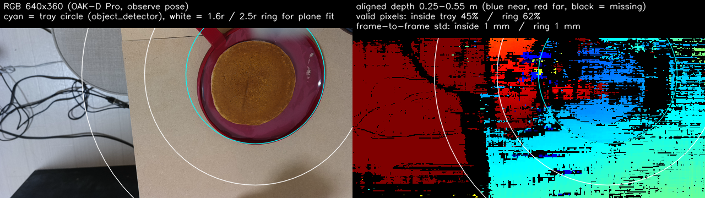

観測姿勢からの RGB（左）と位置合わせ深度（右）。水色がトレイの円、白が平面推定に使うリング（半径の 1.6〜2.5 倍）。トレイの内側は深度の有効画素が 45% しかなく、残った画素も横縞状に乱れている。リング内の台面は 62% が有効で、フレーム間の揺れは 1 mm。この差が「表面を読まず、周囲に平面を当てる」理由である。

細かい工夫は次の通り。

- **台以外の平面に引っ張られない。** リング内の深度の中央値 ±10 cm の点だけを使い、候補が複数あれば最も低い平面（台）を選ぶ。床やパンケーキの面に乗らない。
- **高さの違う点は高さに合わせた面で切る。** トレイ中心は縁の円（台面 +18 mm）から求まるので、縁の高さの面で視線を切ってから台面に落とす。取っ手の板は台面 +32 mm なので、その高さに平行移動した面で切る。台面で切ると「高さ × 水平距離 ÷ カメラ高さ」だけカメラから遠い側に約 1 cm ずれ、観測姿勢によっては横方向の誤差になって把持を外した。ログの座標と幾何から原因を突き止めて修正した。
- **接近中は深度を使わない。** 観測で記憶した座標と関節角の実測だけで動く。

### 3.2 料理を載せたトレイでも中心がぶれない検出

重心や内接円では、トレイに物を載せると赤領域が欠けて中心がずれる。最初は赤い輪郭点に RANSAC で円を当てたが、パンケーキが縁まで覆うと輪郭がパンケーキの縁に引きずられ、中心が 3〜5 cm ずれて把持を外した。

そこで**縁の輪郭そのもの**を捉える方式に変えた。

1. Canny エッジに Hough 円変換をかけて候補を出す。
2. 「円のすぐ内側が赤い」「赤い画素の大半が円の内側にある」という色の整合で候補を絞る。
3. 縁のエッジの支持率が最も高い円を採用する。

探索範囲は学習モデルが出す `tray` 枠（3.7 節）を使い、無ければ赤領域の外接円の 1.8 倍を使う。ラップの反射やパンケーキで赤マスクが欠けても、縁さえ写っていれば中心はぶれない。

取っ手は「円の 1.15 倍の外側に残る赤領域」として分離し、その軸の**向き**だけを使う。把持点は計測した画素の位置ではなく、**トレイ中心から CAD の板中央までの距離 108 mm × 計測した向き**で決める。画素から求めた距離は高さの違いで 2〜3 cm ずれるためである。計測した距離が 5〜16 cm を外れたら向きも信用せず、観測し直す。

### 3.3 数度たわむ安価なサーボで数 mm の把持精度を出す

- **移動 → 実測 → 補正。** 目標角へ cos 補間で動かした後、実測角と目標角の差に 0.8 を掛けて指令に上乗せする。これを最大 3 回繰り返し、重力による 2〜6° の偏差を吸収する。トレイ中心の真上 9.9 cm に 2 mm で到達し、2 サイクルの再現性は 3〜5 mm だった。
- **TF は実測角で計算する。** アームが垂れていてもカメラ位置の計算は正しい。
- **動かない関節は補正を打ち切る。** 指令を変えても実測が動かない関節は、サーボ内部の制限か干渉と判断して止める（暴走防止）。

### 3.4 URDF 直読みの自前 FK/IK と「放射状接近」

MoveIt は使わず、`/robot_description` の URDF を直接パースして FK を作った。IK は SciPy の `least_squares` で「TCP 位置 + 接近方向」の残差を最小化する。5 関節のうち手首ロールは別に解く。

- **土台側へ傾けて接近する。** 工具軸を鉛直から「土台 → 目標」の水平方向へ 20〜50° 傾ける。逆向きの傾きは手首の可動域（±102°）に当たってほとんど解けないことを、到達性マップを作って確認した。
- **手首ロールは 2 段階で解く。** 把持時は「指の閉じ方向 ⟂ 取っ手」になるロールを選ぶ。配置時は、把持した瞬間の取っ手ベクトルをグリッパ座標系で記憶しておき、それが base 座標で「手前向き」になるロールを符号込みで解く。掴んだ向きによらず、置くときは必ず取っ手が手前を向く。
- **回すのは置き位置の上空で、工具軸を鉛直にしてから。** 鉛直軸まわりの回転ならトレイが傾かず、料理が滑らない。

### 3.5 「掴めたか」を判定してやり直す

グリッパを閉じた後の**停止角度と負荷**（サーボの Present_Load）で把持を判定する。

| 状態 | 停止角 | 負荷 |
|---|---|---|
| 取っ手の板を挟んだ | 約 8° | 約 200 |
| つまみ部分を挟んだ | 約 18° | 約 500 |
| 空振り | 1° | 約 30 |

空振りなら開いて上げ、観測からやり直す。

### 3.6 見えないときに探す

正面で見えなければ肩旋回を振って探す。検出ノードは画面端で見切れた赤領域の位置を「ヒント」として出し、controller はその画像内角度に 1.5 倍（カメラが旋回軸から離れているため）を掛けて次の旋回角を決める。見つかった角度はファイルに覚え、次回はそこから見る。床の赤い物を拾わないように、推定した高さが台面 ±5 cm を外れた検出は捨てる。

### 3.7 「パンケーキが載ったら運ぶ」を学習済み物体検出で実現

配膳では「空のトレイを運ばない」「パンケーキが載ったら運ぶ」という判断が要る。これを**自前データで微調整した YOLOv8n**で行う。クラスは pancake / candy / cake / tray の 4 つで、本番の対象はパンケーキだが、同じ仕組みでアメやケーキも判定できるように学習してある。

**判定の仕組み**

- 画像全体で推論し、pancake（設定により candy / cake も）の枠の中心がトレイの円の内側にあれば「パンケーキが載った」とする。
- トレイの円は色ベースの検出ノードの外接円を使い、無ければ学習モデルの `tray` 枠に内接する円で代用する。
- 枠の長辺がトレイ直径の 0.98 倍を超える検出は、トレイ自体の誤検出として除く。
- controller は「パンケーキが載った」が 2 秒続いてから pick & place を始め（`auto` コマンド）、把持の直前にも再確認する。置いたあと再び待つ `auto_loop` もある。

**トレイも学習で検出する**

ラップを掛けたトレイは反射で赤色の判定が崩れ、隣のピンク色のホットプレートも色で紛れるため、色だけではトレイを見失う場面が出た。そこでトレイの枠（円盤のみ）も教え、学習モデルの `tray` 枠を色ベースの円検出の探索範囲として渡す構成にした。色の手がかりは取っ手の向きを見るためだけに使う。

**学習データと結果**

| 項目 | 内容 |
|---|---|
| 画像 | 115 枚（手首カメラとスマホ）。パンケーキ 80 個、アメ 9 個の枠、空のトレイや電池など「対象でない」例 30 枚 |
| アノテーション | 自作ツール |
| 学習 | Jetson の GPU（CUDA 12.6）で 60 エポック、約 6 分 |
| 検証 mAP50 | pancake 0.995、tray 0.995、candy 0.37（アメは枠が 9 個しかなく、データ追加で改善見込み） |
| 推論 | 入力 416 px、GPU で約 35〜40 ms。640×360 の画像では確信度が低めに出るので、しきい値 0.08 |

**経緯（現在は使っていない）**

最初は学習なしで済ませようと、COCO 80 クラスの YOLOv8n/s/m・YOLO11s と、語彙を言葉で与えられる YOLO-World を試した。COCO モデルは 640×360 のカップケーキを認識できず、YOLO-World は位置は取れる（確信度 0.1〜0.2、CPU で約 1 秒）がアメとケーキを区別できなかった。見逃しに備えた色フォールバック（円の内側の「赤でない画素」の割合）も、手やラップの反射で誤判定した。自前学習に切り替えた時点で、どちらもコードから削除した。

**実機の画面**

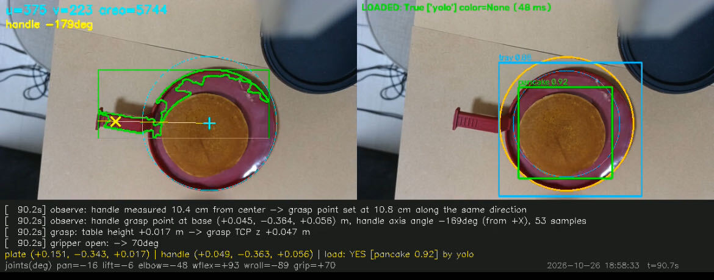

パンケーキを載せたトレイを観測姿勢から見たところ。

- **左（object_detector）**: 緑の輪郭が HSV の赤マスク。パンケーキとラップの反射で赤は左上の三日月形しか残っていないが、水色の円（Hough 円 + 色の整合）は縁を正しく捉えている。水色の十字が中心、黄色の × が取っ手の把持画素、黄色の線が取っ手の軸。
- **右（load_detector）**: 水色が `tray 0.86`、緑が `pancake 0.92`。橙の円は判定に使うトレイの円で、パンケーキの枠の中心がその内側にあるので LOADED。GPU 推論 48 ms。
- **下（controller のログ）**: 取っ手の計測距離 10.4 cm を CAD 値 10.8 cm に置き換えて把持点を決め、TCP 高さと開き角 70° を設定している。

### 3.8 安全設計（実機ならではの工夫）

開発中に 複数プロセスが同じシリアルバスに書き込んでアームが暴走したことと、電源容量不足でサーボがリセットしてアームが床を叩いた。対策として次を実装した。

- シリアルバスの**排他ロック**。2 つ目のプロセスは起動を拒否する。
- 連続読み取り失敗・リセット検知で**指令停止**。加速度制限と P ゲイン調整。
- IK の関節範囲にサーボ内部の位置制限を反映。**経路上の最低高さ**を 41 分割で検査し、TCP 高さに下限を設け、台面近くからの大移動前に 6 cm 持ち上げる。
- controller は既定で `dry_run`（指令を出さずログだけ）。実機で動かすときだけ明示的に解除する。

### 3.9 CAD からのキャリブレーション

カメラ取付位置は実測せず、自作ブラケット・グリッパ・トレイの CAD（USDZ）から寸法を読み取って算出した（±5 mm）。カメラの上下逆取付と関節原点のずれは、「基準姿勢で測ったトレイ位置を別姿勢の TF で画像に再投影し、実測画素と比較する」方法で検出して修正した。

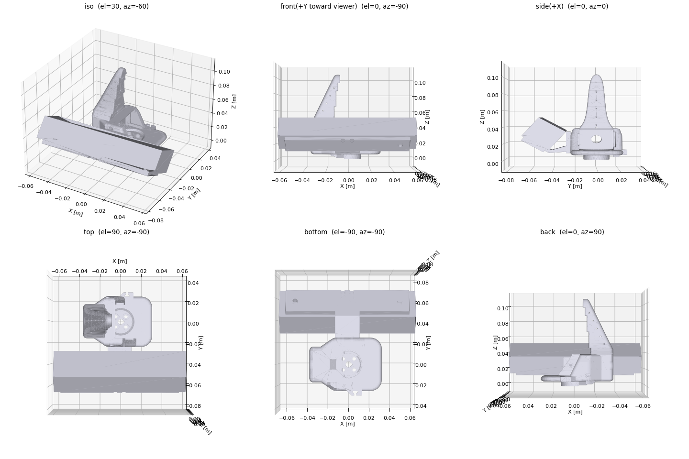

カメラ取付ブラケットの CAD と取付値の算出。

### 3.10 自分のプログラムを教材にした ROS 2 の勉強用資料

1.2 節の通り、本課題の目的の 1 つは ROS の理解を深めることだった。ただ、動くものを作ることを優先すると、トピック・TF・パラメータ・launch といった概念と、実際に自分のリポジトリにあるコードとの対応が頭の中で結びつかないまま進みがちだった。

そこで、完成した本プログラムそのものを教材にして ROS 2 の基本概念を説明する入門資料を AI に書かせた（`docs/ROS2学習資料_SO101_PickPlace.md`、約 5 万字）。構成は次の通り。

- ROS 2 の基本概念（ノード、トピック、パラメータ、TF、launch）を、本プログラムのどのコードが該当するかと対応づけて説明
- 題材 5 つ: カメラノード（Publisher）、検出ノード（Subscriber と Publisher の組み合わせ）、推定ノード（座標系と TF）、モータブリッジ（ハードウェア I/O と安全）、制御ノード（状態遷移・運動学・dry_run）
- launch と params.yaml の仕組み、演習課題（読む・動かす・改造する）、用語集

一般のチュートリアルと違い、説明に出てくるトピック名や関節名、パラメータが全部自分の手元で動いているものなので、読んだことをすぐ `ros2 topic echo` などで確かめられる。開発の副産物として教材が残り、サークルの他のメンバーへの引き継ぎにも使える。

---

## 4. AI の活用

### 4.1 ロボット側の推論（学習済みモデル）

- **ゼロショットで始め、弱点だけ学習で補った。** まず学習なしの YOLO-World で「パンケーキが置かれたら運ぶ」仕組みを作り、小さなアメの名前が区別できないという弱点を確認してから、自前データ 115 枚で YOLOv8n を微調整した（3.7 節）。
- **意味的な判断だけを学習モデルに任せた。** トレイの位置と取っ手の把持点は、決定論的な画像処理（HSV、Hough 円変換）と数値最適化（IK）で求める。赤いトレイという限定環境では、学習モデルより精度と原因究明のしやすさで優れると判断した。

### 4.2 開発プロセスでの AI

LLM ベースのコーディングエージェント（Claude Code）を Jetson 上で動かし、人と対話しながら次を行った。

- 環境調査、ROS 2 ノード・launch・URDF の設計と実装、パラメータ設計
- 実機ログの解析による原因究明（取っ手の 1 cm ずれの幾何的原因、床の平面を拾った問題、controller の二重起動など）
- CAD（USDZ）の寸法読み取りとカメラ取付値の算出、到達性マップの作成
- 安全ルールの提案（バスロック、リセット検知）と事故後の対策実装
- 本プログラムを題材にした ROS 2 の勉強用資料の作成（3.10 節）

人は「取っ手を掴む」「置くときは手前向き」「左に少しずらして」といった要求と実機での観察結果を与え、AI が実装と検証を担う分業で、約 2 週間で実機の自律動作に到達した。

**発展**。トレイ位置の検出部も学習モデルに置き換えられる構成にしてある（検出ノードの出力は「中心画素・外接円・取っ手画素」だけ）。色に依存しない一般の食器に広げる段階で、セグメンテーションモデルを導入する予定である。

---

## 5. 結果

| 項目 | 結果 |
|---|---|
| トレイ中心の base 座標の再現性（5 姿勢） | 1〜3 cm（OAK 深度と平面フィットの揺れが支配的） |
| トレイ中心の真上 9.9 cm への到達誤差 | 2 mm（補正 3 回後） |
| 2 サイクル間の到達位置の差 | 3〜5 mm |
| 取っ手の把持 → 持ち上げ → 配置 → 復帰の自律実行 | 成功（把持判定: 閉じ角 18°、負荷 500） |
| 観測から配置完了までの時間 | 約 1 分（関節速度を 15°/s に制限しているため） |
| パンケーキ検出（YOLO-World ゼロショット、CPU） | カップケーキを検出（確信度 0.1〜0.2）、約 1 s/推論。アメは `candy` と名付けられず |
| パンケーキ検出（微調整した YOLOv8n、GPU） | 検証 mAP50 pancake 0.995 / tray 0.995 / candy 0.37、約 35〜40 ms/推論。包み紙のアメを `candy` 0.82 で検出 |

実機の画面は 3.7 節の図を参照。

---

## 6. うまくいかなかったこと・反省・考察

- **近距離深度の限界。** D455 は 25 cm 未満で全欠損、OAK は IR ドットの誤マッチ。「深度カメラがあれば 3D が取れる」という前提が実機では崩れた。台平面方式で回避したが、台が無地の平面であることに依存している。
- **把持の左右非対称。** 可動爪は板を固定爪へ寄せるが、板が固定爪の先端に当たると押してしまう。狙いを可動爪側に寄せ（板を固定爪の内側面から約 29 mm）、開き角も 60° から 70° に広げて対処したが、根本的には把持直前にカメラで指と板の相対位置を見る近接確認が必要。
- **空振りがトレイを動かす。** 失敗すると取っ手を押してトレイが 2〜3 cm 動く。やり直しの観測で追従できるが、料理を載せた状態では望ましくない。
- **電源とハーネス。** 付属の 12 V 2 A では負荷姿勢でサーボがリセットした。5 A 以上に交換して解消。手首以降の配線でも電圧低下の兆候があり、低価格アームでは電源系の確認を最初に行うべきだった。

- **複数プロセスの管理。** 同じバスに 2 つのプロセスが書き込む、controller を再起動したつもりが子プロセスが残って二重になる、といった運用ミスが事故や混乱の原因になった。排他ロックと pid 管理で対処したが、launch ファイルでの一括管理に移行すべきである。
- **成功率の統計が未取得。** 一連の自律動作は成功したが、10 回規模の試行で成功率を出すところまで至っていない。


---

## 7. 今後の展望

1. **持ち上げたときのトレイの傾きを抑える。** 取っ手の板を片持ちで掴むため、持ち上げると自重でトレイが傾き、パンケーキが滑るおそれがある。把持点を工夫する、ハンドの改造をするなどを試す。
2. **把持直前の近接視覚フィードバック。** 指と取っ手の相対位置を画像で見て左右のずれを補正し、固定爪の先端が板に当たる失敗（6 章）をなくす。
3. **他の工程・ロボットとの連携。** 同じ SO-101 が担う工程 ①（パンケーキメーカーを開ける）を同じ controller に組み込み、工程 ③ のロボットから「お皿に乗せた」合図を ROS 2 のトピックで受けて `auto` の待ちと接続する。
4. **成功率の計測と向上。** 10 回以上の連続試行で成功率を出し、失敗の内訳（空振り、トレイの移動、IK 失敗）ごとに対策する。あわせて launch ファイルでの一括起動に移行し、運用ミスを減らす。


---

## 8. 使用した公開ソフトウェア・設計データ

- SO-ARM100 / SO-101（TheRobotStudio、Apache-2.0）: アーム本体の設計。グリッパは本課題で改造。
- Lerobot_ros2（AgRoboticsResearch、MIT 表記）: SO-101 の URDF とモーターブリッジ。ブリッジは安全機能を追加して改変。
- LeRobot（Hugging Face、Apache-2.0）: Feetech サーボ通信コード。
- ROS 2 Humble、tf2、robot_state_publisher、xacro（Apache-2.0 / BSD）、OpenCV（Apache-2.0）、NumPy・SciPy（BSD）、depthai（MIT）。
- ultralytics（YOLOv8 実装と事前学習重み、**AGPL-3.0**。本リポジトリは public で公開）、PyTorch・torchvision（BSD-3）。開発途中で試した YOLO-World と CLIP は現在は使っていない。

詳細は `THIRD_PARTY_NOTICES.md` を参照。
